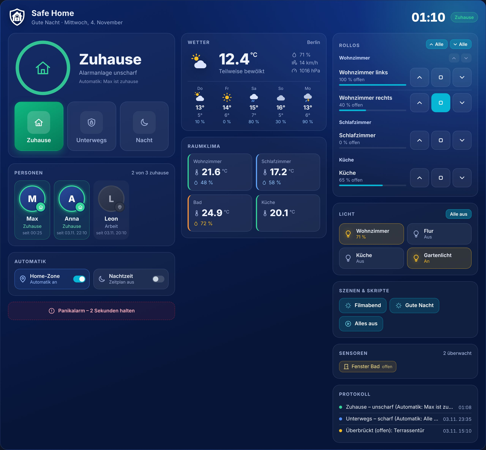
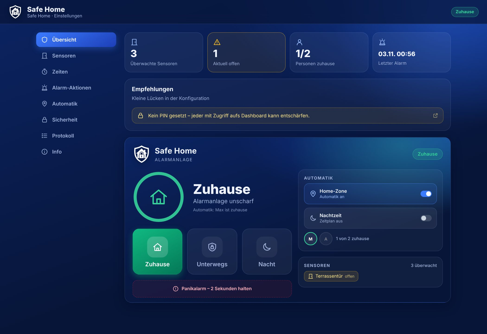
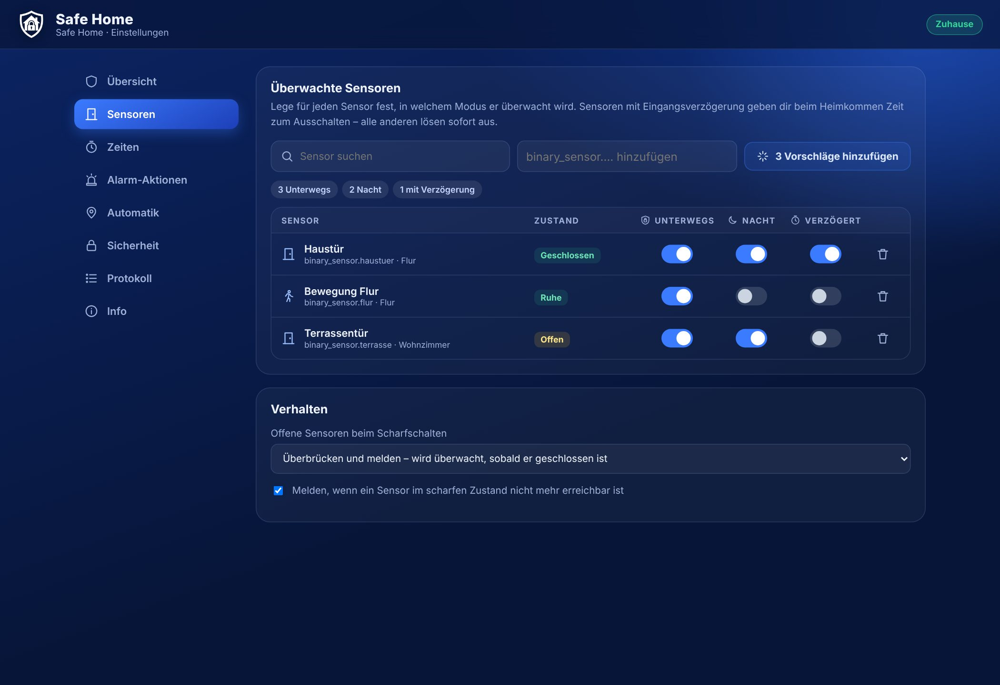
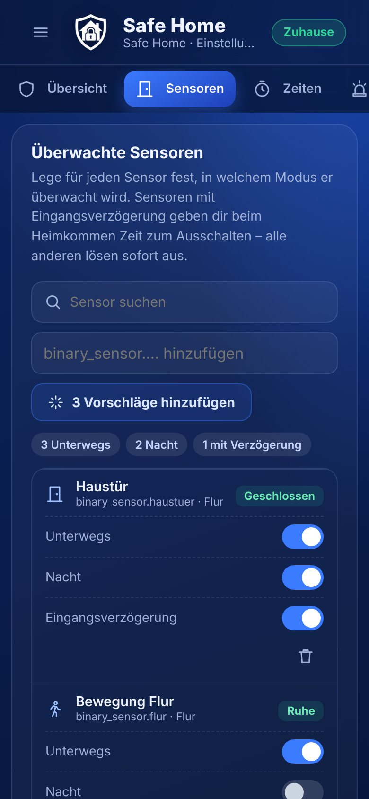
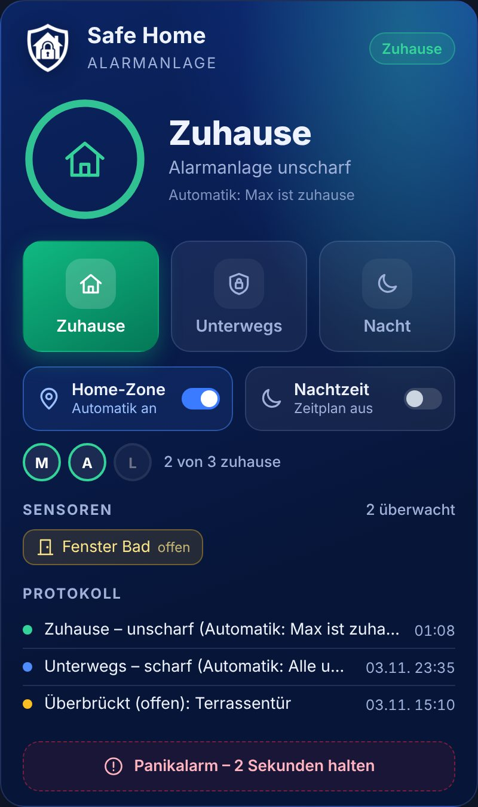
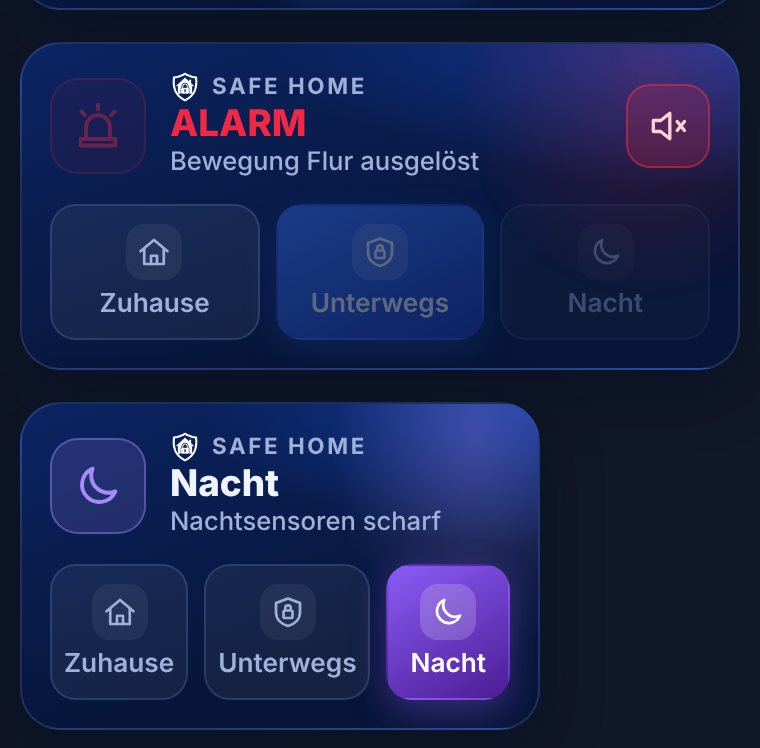
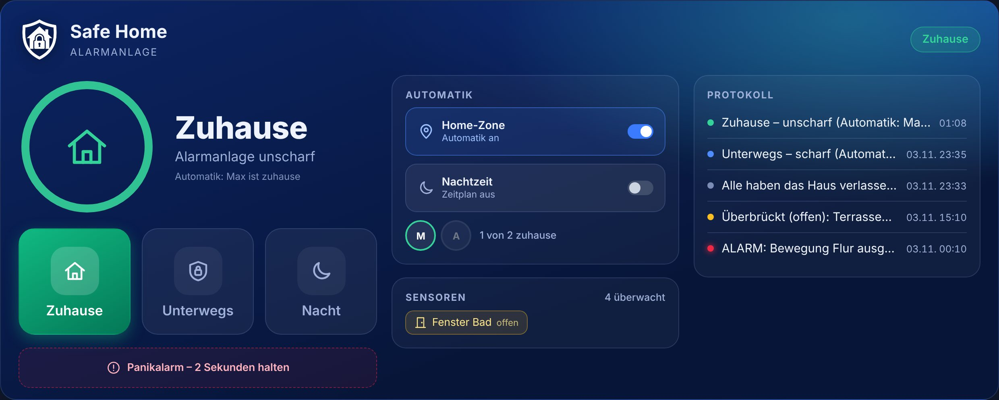
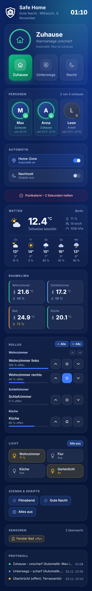

<p align="center">
  
</p>

<h1 align="center">Safe Home</h1>
<p align="center"><b>Die Alarmanlage für Home Assistant – weitestgehend automatisch.</b></p>

<p align="center">
  
  
  
</p>

<p align="center"><a href="README.md">English</a> · <b>Deutsch</b></p>

> **Sprachen:** Safe Home ist vollständig auf **Deutsch und Englisch** verfügbar – Einrichtung, Dashboard-Karten, Karten-Editor, Seite in der Seitenleiste, Protokoll, Benachrichtigungen und Ansagen. Karten und Seitenleiste richten sich nach der Sprache deines Home-Assistant-Benutzerprofils, Protokoll, Benachrichtigungen und Ansagen nach der Systemsprache (*Einstellungen → System → Allgemein*). Alle anderen Sprachen verwenden Englisch.

<p align="center"></p>

---

📝 **Neu in dieser Version:** siehe [Release Notes](CHANGELOG.de.md).

## Funktionen

**Drei Modi**
| Modus | Zustand | Überwacht |
|---|---|---|
| 🏠 **Zuhause** | Ausgeschaltet (unscharf) | nichts |
| 🛡️ **Unterwegs** | Scharfgeschaltet | alle ausgewählten Sensoren |
| 🌙 **Nacht** | Teilweise scharf | nur die für die Nacht gewählten Sensoren |

**Teilbereiche**
- Bis zu **3 Teilbereiche** (z. B. Garage, Nebengebäude, Werkstatt) neben der Haupt-Alarmanlage – jeweils mit eigenem Namen, eigenen Sensoren, Verzögerungen, Kernzeiten und Anwesenheit. Siehe [Teilbereiche](#teilbereiche).

**Automatik**
- **Automatisch scharf**, sobald alle ausgewählten Personen die Home-Zone verlassen haben (mit einstellbarer Wartezeit).
- **Automatisch unscharf**, sobald die erste Person nach Hause kommt – auch während der Eingangsverzögerung oder eines laufenden Alarms.
- **Nachtmodus nach Zeitplan** (z. B. 23:00–06:30) – abhängig davon, wer zuhause ist.
- **Weitestgehend autonom nach Uhrzeit und Standort** – siehe [Tag- und Nacht-Automatik](#tag--und-nacht-automatik).
- Beide Automatiken lassen sich jederzeit über Schalter im Dashboard ein- und ausschalten.

**Bei einem Alarm**
- Sirenen / akustische Signalgeber einschalten (`siren`, `switch`, `input_boolean`, `script`) – **fein einstellbar**: nur in bestimmten Modi, nur in einem Zeitfenster und für jeden Sensor einzeln (siehe [Akustischer Alarm](#akustischer-alarm))
- Alarmbeleuchtung rot einschalten (wird beim Unscharfschalten wieder ausgeschaltet)
- Push-Benachrichtigung an die Companion App – auf Wunsch als **kritische Benachrichtigung** (umgeht Lautlos/Fokus), mit **Kamera-Schnappschuss** und Tasten **„Sirene stumm“** und optional **„Entschärfen“** (mit Geräte-Entsperrung)
- **Sprachansagen** über Lautsprecher (TTS), abschaltbar – passend zur Art des Melders, z. B. *„Achtung, möglicher Einbruch! Geöffnetes Fenster erkannt: Küche.“* (siehe [Art der Sensoren & Ansagen](#art-der-sensoren--ansagen))
- **WhatsApp über TextMeBot** – direkt in der Integration, mit dem ausgelösten Melder, **Eskalation** an weitere Empfänger, wenn der Alarm nicht ausgeschaltet wird, und Entwarnung
- Persistente Benachrichtigung in Home Assistant
- Ereignis `safe_home_triggered` für eigene Automationen

**Sicherheit & Komfort**
- **Ausgangsverzögerung** und **Eingangsverzögerung** getrennt für Unterwegs und Nacht – die Ausgangsverzögerung lässt sich auf jeder Karte mit **„Sofort scharf schalten“** überspringen
- Nur ausgewählte Sensoren (z. B. Haustür) mit Eingangsverzögerung – alle anderen lösen sofort aus
- **Offene Fenster beim Scharfschalten**: überbrücken und melden oder Scharfschalten verhindern. Ein überbrückter Sensor wird automatisch wieder überwacht, sobald er geschlossen wurde.
- **Sabotage-/Funkverlust-Erkennung**: Meldung, wenn ein Sensor im scharfen Zustand nicht mehr erreichbar ist
- Optionaler **PIN-Code** (Ziffern oder Text), Meldung bei falscher PIN-Eingabe
- **Panikalarm** (Taste in der Karte 2 Sekunden halten oder Dienst `safe_home.panic`)
- Schutz vor Fehlalarmen nach Neustarts: nur echte Wechsel von „geschlossen“ auf „offen“ lösen aus
- Zustand und Protokoll bleiben über Neustarts erhalten
- Ereignisprotokoll (letzte 30 Einträge)

---

## Installation

### Über HACS (empfohlen)
1. HACS → ⋮ → **Benutzerdefinierte Repositories** → `https://github.com/digital7even/safe_home`, Kategorie **Integration**.
2. **Safe Home** installieren und Home Assistant neu starten.
3. **Einstellungen → Geräte & Dienste → Integration hinzufügen → Safe Home**.

### Manuell
Den Ordner `custom_components/safe_home` nach `config/custom_components/safe_home` kopieren und Home Assistant neu starten.

> Die Dashboard-Karte wird von der Integration automatisch geladen – eine Ressource muss **nicht** manuell angelegt werden. Nach einem Update ggf. den Browser-Cache leeren bzw. die App neu laden.

---

## Safe-Home-Seite in der Seitenleiste

Nach der Installation erscheint **Safe Home** in der Seitenleiste (nur für Administratoren). Dort lässt sich alles übersichtlicher einstellen als im Einrichtungsdialog – im gleichen Design wie die Karten.

| Übersicht | Sensoren | Smartphone |
|---|---|---|
|  |  |  |

| Bereich | Inhalt |
|---|---|
| **Übersicht** | Kennzahlen (überwachte/offene Sensoren, Personen zuhause, letzter Alarm), Empfehlungen zu Lücken in der Konfiguration und die Steuerung der Alarmanlage |
| **Bereiche & Sensoren** | **Bereiche** (Name der Alarmanlage, bis zu 3 **Teilbereiche**), **Überwachte Sensoren** (Art, Bereich, *Unterwegs*/*Nacht*/*Verzögert* je Sensor, Vorschläge), **Verzögerungen** (Ausgangs-/Eingangsverzögerung mit Live-Ablauf), **Überwachung** (offene/nicht erreichbare Sensoren, Batterien) |
| **Alarm-Aktionen** | **Sirene & Licht** (Sirenen, Alarmlicht, Sirenen-Regeln, Sirene je Sensor, Alarm- und Sirenendauer), **Benachrichtigungen** (Smartphones, kritisch, Entschärfen-Taste, Kamerabild), **Sprachansagen**, **WhatsApp**, **Testen** inkl. [echtem Alarm von einem Sensor](#alarm-von-einem-sensor-auslösen) |
| **Automatik** | **Anwesenheit**, **Wochenplan**, **Nachtmodus** und eine Zusammenfassung, wie Safe Home selbstständig handelt |
| **Haushalt** | Haushalt überwachen, **Melden per** Push / WhatsApp / Ansage / Entwarnung, Sensoren mit Meldezustand |
| **Sicherheit** | **PIN-Eingabe** (PIN zum Scharf- und Stummschalten, Meldung bei falschem PIN, Sperre) und **PINs verwalten** – persönliche PINs für jeden Home-Assistant-Benutzer und Gast-PINs mit Zeitraum (siehe [PINs](#pins)) |
| **Protokoll** | Die letzten 30 Ereignisse, filterbar nach Alarmen, Schaltungen und Warnungen |
| **Info** | **Android-Widget-Generator**, Status der Dashboard-Ressource, Version, Links, Dankeschön |

Die Abschnitte in den Reitern sind **zugeklappt** und öffnen sich per Tipp auf die Überschrift – besonders übersichtlich auf dem Smartphone. Unter *Info → Darstellung* lässt sich *Einstellungen standardmäßig ausklappen* anhaken (gilt je Browser/Gerät).

Änderungen werden erst mit **Speichern** übernommen (die Leiste unten erscheint automatisch). Vor dem Speichern prüft Safe Home alle Angaben und markiert Fehler. Bei mehreren Instanzen wählst du oben rechts die gewünschte aus.

### Android-Widget (Companion App)

Unter **Info → Android-Widget** erzeugt Safe Home ein fertiges **Template-Widget** für den Android-Startbildschirm im Stil der Kompakt-Karte: farbiger Zustand mit Symbol, Hinweiszeile (z. B. Auslöser oder „bis 16:45:30“ während einer Verzögerung) und die drei Modi, der aktive hervorgehoben. Optional: Personen zuhause, offene Sensoren, dunkelblauer Hintergrund.

1. **Template kopieren** tippen.
2. Startbildschirm lange gedrückt halten → Widgets → Home Assistant → **Template** auf den Startbildschirm ziehen.
3. Template einfügen, speichern.

Die Vorschau auf der Safe-Home-Seite wird von deinem Home Assistant berechnet. Das Template-Widget kann nur Text mit einfacher Formatierung anzeigen; Tippen aktualisiert es. Zum Schalten der Modi eignen sich zusätzliche Button-Widgets mit `alarm_control_panel.alarm_arm_away`, `alarm_arm_night` und `alarm_disarm`. Details: [Android-Widgets der Companion App](https://companion.home-assistant.io/docs/integrations/android-widgets).

## Einrichtung

Der Einrichtungsassistent führt durch fünf Schritte. Alles kann später auf der **Safe-Home-Seite in der Seitenleiste** oder unter **Safe Home → Konfigurieren** geändert werden.

1. **Name & PIN** – optionaler PIN-Code, wahlweise auch fürs Scharfschalten.
2. **Sensoren** – Sensoren für *Unterwegs*, für *Nacht* und welche davon eine *Eingangsverzögerung* haben.
3. **Verzögerungen** – Ausgangs-/Eingangsverzögerung, Alarmdauer, Dauer des akustischen Alarms, erneutes Scharfschalten nach dem Alarm.

**Zwei Alarmdauern:**

| Einstellung | Bedeutung |
|---|---|
| **Alarmdauer** | So lange bleibt der Alarm aktiv. Danach wird wieder scharf geschaltet (falls aktiviert), sonst bleibt der Alarm bis zum Ausschalten. `0` = bis zum Ausschalten. |
| **Dauer des akustischen Alarms** | So lange ertönen Sirenen und Signalgeber. Danach bleibt der Alarm **still** bestehen – Benachrichtigungen, WhatsApp und Alarmlicht laufen weiter. `0` = während der gesamten Alarmdauer. |

Beispiel: Alarmdauer 10 Min., Sirene 3 Min. → 3 Minuten Sirene, 7 Minuten stiller Alarm, danach wieder scharf. Beide Werte werden auf der Safe-Home-Seite als Stunden/Minuten/Sekunden eingestellt, die Ablaufgrafik zeigt beide Phasen. Manuelles Stummschalten beendet nur die Sirene – die Alarmdauer läuft weiter. Bestehende Installationen übernehmen die bisherige Alarmdauer auch als Sirenendauer.
4. **Aktionen** – Sirenen, Alarmlicht, Smartphones mit Companion App (z. B. `mobile_app_mein_handy`), Kameras, Sprachausgabe.
5. **Automatik** – Personen für die Home-Zone, Auto-Scharf/-Unscharf, Nachtmodus-Zeitplan.

**Empfehlung:** Haustür in *Eingangsverzögerung*, Bewegungsmelder **nicht** – so kannst du beim Heimkommen entschärfen, Einbrecher über Fenster lösen sofort aus.

---

## Wochenplan

Unter **Automatik → Wochenplan** zeichnest du einen Wochenkalender (Montag–Sonntag): Balken für **Unterwegs** (orange) oder **Nacht** (lila) per Ziehen eintragen; außerhalb der Balken ist die Anlage **unscharf**. An den Rändern ziehen ändert die Zeit, den Balken ziehen verschiebt ihn, mit *Unscharf* radierst du Zeiten weg. Raster: 15 Minuten. *Montag auf Di–Fr kopieren* und *Alles leeren* helfen beim Einrichten.

- Der Wochenplan ist **nur aktiv, wenn „Anwesenheit“ in der Automatik ausgeschaltet ist** – sonst ist der Bereich ausgegraut und zeigt einen Hinweis.
- Zum Beginn eines Balkens schaltet Safe Home scharf (mit der normalen Ausgangsverzögerung), zum Ende unscharf – aber nur, wenn der Wochenplan scharf geschaltet hat. Von Hand gewählte Modi und laufende Alarme bleiben unangetastet.
- Balken, die über Mitternacht aneinanderstoßen (z. B. Di 22–24 Uhr und Mi 0–6 Uhr), gelten als ein Zeitraum.
- Solange der Wochenplan aktiv ist, ist der **Nachtmodus-Zeitplan pausiert** (unter *Automatik* ausgegraut, der Schalter in der Karte zeigt *Pausiert (Wochenplan)*) – so überschneiden sich beide nie.

## Batterie-Überwachung

Safe Home prüft die Batterien aller überwachten Sensoren – Hauptbereich und Teilbereiche. Gefunden wird die Batterie-Entität desselben Geräts (`sensor` mit Geräteklasse *Batterie* in %, oder ein binärer Sensor *Batterie schwach*) oder das Attribut `battery_level` des Sensors selbst.

- Unter der Schwelle (Standard **20 %**, einstellbar 5–90 %) erscheint der Sensor als gelber Chip im Sensorbereich der Karten und unter *Bereiche & Sensoren → Batterien*, das Protokoll erhält einen Eintrag und – wenn aktiviert – kommt eine Push-Nachricht.
- Jede Batterie wird **nur einmal** gemeldet (auch über Neustarts hinweg), bis sie gewechselt wurde; als gewechselt gilt sie 5 % über der Schwelle.
- Alles ist abschaltbar: *Batterien der Sensoren überwachen* und *Push-Benachrichtigung bei schwacher Batterie*.

## Tag- und Nacht-Automatik

Safe Home entscheidet anhand von **Uhrzeit** und **Standort der Personen** selbst, welcher Modus gilt. Die Safe-Home-Seite zeigt unter **Automatik → So handelt Safe Home selbstständig** die Regeln mit deinen aktuellen Zeiten.

| Situation | Safe Home |
|---|---|
| Letzte Person verlässt die Home-Zone | Nach der Wartezeit **Unterwegs** – auch direkt aus dem Nachtmodus (z. B. morgens nach dem Unscharfschalten). |
| Erste Person kommt heim | **Unterwegs aus**. Ist gerade Nachtzeit, wird nach der eingestellten Wartezeit (Standard 10 Min.) wieder der **Nachtmodus** aktiv. |
| **Nachtbeginn**, jemand ist zuhause | **Nachtmodus**. War Unterwegs automatisch aktiv, wechselt es in den Nachtmodus. |
| **Nachtbeginn**, niemand zuhause | **Kein Nachtmodus** – Unterwegs bleibt aktiv bzw. wird eingeschaltet. |
| Jemand kommt **nachts** heim, die anderen schlafen | Kurz unscharf (die Haustür löst nicht aus), nach der Wartezeit wieder Nachtmodus. |
| **Nachtende**, jemand zuhause | Unscharf („Guten Morgen“). |
| **Nachtende**, niemand mehr da | Nicht unscharf, sondern **Unterwegs** – das leere Haus bleibt geschützt. |

- Alle Schritte, die auf Personen reagieren, gelten nur bei **eingeschalteter Home-Zone-Automatik** (Schalter „Anwesenheit“). Ohne sie schaltet Safe Home nur nach Zeitplan und schaltet ein leeres Haus morgens nie unscharf.
- **Von Hand gewähltes Unterwegs** wird von der Automatik nie überschrieben.
- **Ein Schalter je Automatik:** Home-Zone-Automatik und Nachtmodus werden ausschließlich über ihren Schalter ein- und ausgeschaltet – „Anwesenheit“ und „Nachtzeit“ auf den Karten bzw. oben im Reiter Automatik (derselbe Schalter, wirkt sofort, ohne Speichern). Im Reiter stehen sonst nur die Details: Personen, Wartezeiten, Uhrzeiten und was die Home-Zone-Automatik tut (beim Verlassen scharf / beim Heimkommen unscharf).
- Neue Einstellung: **Nach Heimkehr in der Nacht wieder Nachtmodus nach … Minuten** (0 = bleibt unscharf).

---

## Alarm von einem Sensor auslösen

Damit du sicher sein kannst, dass im Ernstfall alles funktioniert, lässt sich unter *Alarm-Aktionen → Testen* ein Alarm **ausgehend von einem angelegten Sensor** auslösen – so, als hätte er gemeldet:

1. **Alarmanlage** (Hauptbereich und Teilbereiche) oder **Haushalt** wählen.
2. Sensor auswählen und **Alarm auslösen** drücken – mit einem zweiten Klick bestätigen.
3. Sirenen, Alarmlicht, Ansage, Push (mit Kamerabild) und WhatsApp laufen **genau wie bei einem echten Alarm** – mit dem echten Wortlaut des Sensors, z. B. *„Fenster geöffnet: Küche“*. Das Wort „Test“ taucht nirgends auf.
4. **Rückstellung** beendet alles und stellt den Zustand davor wieder her (z. B. unscharf oder scharf *Nacht*). WhatsApp-Empfänger erhalten die übliche Entwarnung.

Entschärfen über eine Karte beendet den Alarm ebenfalls. Ist die Alarmdauer abgelaufen, stellt Safe Home automatisch zurück, statt wieder scharf zu schalten. Sag vorher Mitbewohnern und WhatsApp-Empfängern Bescheid.

## Art der Sensoren & Ansagen

Für jeden Sensor wählst du im Reiter *Bereiche & Sensoren* (bei binären Sensoren auch unter *Haushalt*) die **Art**: **Türkontakt, Fensterkontakt, Bewegungsmelder, Präsenzmelder, Wassersensor oder Kamera**. Safe Home schlägt die Art anhand der Geräteklasse vor – ein Kontakt, der sich nur als *Öffnung* meldet, lässt sich so z. B. als *Fensterkontakt* einstellen.

Die Art bestimmt die Texte aller Meldungen:

| Art | Push / WhatsApp / Protokoll | Ansage |
|---|---|---|
| Türkontakt | Tür geöffnet: Haustür | Achtung, möglicher Einbruch! Geöffnete Tür erkannt: Haustür. |
| Fensterkontakt | Fenster geöffnet: Küche | Achtung, möglicher Einbruch! Geöffnetes Fenster erkannt: Küche. |
| Bewegungsmelder | Bewegung erkannt: Flur | Achtung, möglicher Einbruch! Bewegung erkannt: Flur. |
| Präsenzmelder | Anwesenheit erkannt: Wohnzimmer | Achtung, möglicher Einbruch! Person erkannt: Wohnzimmer. |
| Kamera | Kamera hat Bewegung erkannt: Einfahrt | Achtung, möglicher Einbruch! Bewegung auf der Kamera erkannt: Einfahrt. |
| Wassersensor | Wasser erkannt: Keller | Achtung, Wasseralarm! Wasser erkannt: Keller. |

Jede Alarm-Ansage endet mit *„Die Bewohner werden benachrichtigt.“* Bei Teilbereichen heißt es *„…möglicher Einbruch im Bereich Garage!“*.

**Sprachansagen** (*Alarm-Aktionen → Sprachansagen*) schaltest du mit einer eigenen Checkbox ein und aus. Ist sie an, wählst du Sprachausgabe-Dienst und Lautsprecher und zusätzlich:
- **Ansage während der Eingangsverzögerung** – *„Bitte Alarmanlage innerhalb von 30 Sekunden ausschalten.“* Sie läuft **in Schleife** mit der Restzeit (*„… noch 20 Sekunden.“*), bis du entschärfst oder der Alarm beginnt – standardmäßig alle 10 s, einstellbar unter *Hinweis wiederholen alle … Sekunden* (0 = nur einmal).

**Eingangsverzögerung kurz erklärt:** Nur Melder mit *Verzögert* (z. B. Haustür) starten den Countdown. Schließen der Tür beendet ihn **nicht** – nur Entschärfen. Meldet während des Countdowns ein Melder **ohne** Verzögerung (z. B. Bewegung im Wohnzimmer), beginnt der Alarm **sofort**.
- **Ansage auch bei Haushalts-Alarm** – z. B. *„Achtung, Wasseralarm! Wasser erkannt: Waschmaschine. Bitte sofort prüfen.“*

**Alexa-Geräte (Alexa Media Player):** Echo-Geräte sind von den Lautsprechern getrennt. Erst mit der Checkbox *Alexa-Geräte verwenden* (standardmäßig aus) lassen sie sich auswählen – sie sprechen dann mit der **normalen Alexa-Stimme** über `notify.alexa_media` (`type: tts`), ganz ohne Sprachausgabe-Dienst. Lautsprecher und Alexa-Geräte lassen sich kombinieren. Wird ein Echo versehentlich unter *Lautsprecher* gewählt, zeigt Safe Home einen Hinweis – es spricht trotzdem mit der Alexa-Stimme. Voraussetzung ist die Integration [Alexa Media Player](https://github.com/alandtse/alexa_media_player).

Eine Vorschau zeigt, wie die Ansagen mit deinen Sensornamen klingen. Standardmäßig wird auch bei einem **stillen Alarm** angesagt (Sirene aus, z. B. außerhalb des Sirenen-Zeitfensters) – mit *Ansage auch bei stillem Alarm* lässt sich ein stiller Alarm ganz still halten. Fällt eine Ansage aus oder meldet Alexa einen Fehler, steht der Grund im Protokoll. Bestehende Installationen mit Sprachausgabe-Dienst und Lautsprechern behalten ihre Ansagen eingeschaltet.

## Teilbereiche

Neben dem **Hauptbereich** – der Alarmanlage mit Zuhause, Unterwegs und Nacht – kannst du im Reiter *Bereiche & Sensoren* bis zu **3 Teilbereiche** anlegen, z. B. *Garage*, *Nebengebäude* oder *Werkstatt*. Der Hauptbereich zählt nicht als Teilbereich und ist immer vorhanden.

| Einstellung | Beschreibung |
|---|---|
| **Name** | Wird in den Karten angezeigt und bei jedem Alarm genannt (Push, WhatsApp, Ansage, Protokoll) |
| **Sensoren** | In der Sensortabelle pro Sensor den **Bereich** wählen. Jeder Sensor gehört genau einem Bereich. Sensoren eines Teilbereichs haben keine Modi – sie sind überwacht, sobald der Teilbereich scharf ist |
| **Sirene** | *Wie Hauptbereich* (die Sirenen unter *Alarm-Aktionen*), *Eigene Sirenen* (z. B. nur die Außensirene an der Garage) oder *Keine Sirene* (stiller Alarm – Benachrichtigungen, Licht und Ansage laufen trotzdem) |
| **Ausgangs-/Eingangsverzögerung** | Eigene Verzögerungen je Teilbereich; *Eingangsverzögerung* je Sensor |
| **Kernzeiten** | Zur Startzeit an den gewählten Wochentagen scharf, zur Endzeit unscharf (z. B. 18:30–06:00, Mo–Fr) |
| **Eigene Anwesenheit** | Scharf, wenn alle gewählten Personen weg sind – unscharf, sobald eine zurückkommt. Unabhängig vom Hauptbereich |

Ein Teilbereich kennt nur **Scharf** und **Unscharf**. Jeder bekommt eine eigene Entität `alarm_control_panel.<name des teilbereichs>` (scharf mit `alarm_arm_away`, unscharf mit `alarm_disarm`, gleicher PIN wie der Hauptbereich).

**Alarme** laufen über dieselben Ausgänge wie beim Hauptbereich: Sirenen (es gelten die Regeln aus *Akustischer Alarm*, außer der Modus-Auswahl), Alarmlicht, Push mit Entschärfen-Knopf, Ansage und WhatsApp – immer mit Namen des Bereichs, z. B. *„🚨 ALARM – Garage“*. Die Sirenen gehen erst aus, wenn kein Bereich sie mehr braucht.

**In den Karten**
- **Kompakt:** bis zu 3 Punkte oben rechts – je Teilbereich einer, eingefärbt nach Zustand (grün unscharf, blau scharf, gelb Verzögerung, rot Alarm). Ein Tipp darauf klappt die Steuerung auf.
- **Standard:** die Teilbereiche stehen direkt unter den Modus-Tasten.
- **Tablet & Custom:** im Karteneditor wählbar – `zones_display: inline` (Liste in der Karte) oder `zones_display: dots` (Punkte). In der Custom-Karte ist die Liste ein eigenes Widget *Teilbereiche*, das sich verschieben und in der Größe ändern lässt.
- Ein Alarm in einem Teilbereich erscheint in allen Varianten als rotes Banner mit Entschärfen-Knopf.

## Haushalt (z. B. Wassersensoren)

Im Reiter **Haushalt** der Safe-Home-Seite lassen sich Sensoren einbinden, die **unabhängig von der Alarmanlage** überwacht werden – auch im Modus Zuhause. Sie lösen keinen Einbruchalarm und keine Sirene aus, sondern melden sich per **Push** und/oder **WhatsApp**.

- **Haushalt überwachen** schaltet das Modul ein (Standard: aus).
- Je Sensor wählst du **„Melden bei“** – z. B. *Feucht* bei einem Wassersensor oder *Trocken* bei einem Feuchtesensor für Pflanzen. Auch andere Entitäten sind möglich (z. B. `sensor.trockner_status` = `fertig`).
- **Vorschläge:** alle Wassersensoren (`device_class: moisture`) mit einem Klick.
- **Entwarnung** („Waschmaschine ist wieder trocken“) optional.
- Unter **Alarm-Aktionen** legst du fest, ob Haushalts-Alarme als **Push** (kritisch, wenn aktiviert) und/oder **WhatsApp** (an Empfänger mit „sofort“) gesendet werden.
- Meldende Sensoren erscheinen auf den Karten im Bereich *Sensoren* (💧) und im Protokoll; für Automationen gibt es das Attribut `household_alerts`.

---

## Akustischer Alarm

Auf der **Safe-Home-Seite → Alarm-Aktionen → Akustischer Alarm** legst du fest, wann Sirenen und Signalgeber ertönen. Oben fasst eine Zeile die aktuelle Einstellung zusammen, z. B. „Sirene ertönt: Unterwegs + Nacht · von 22:00 bis 06:00 Uhr – 4 von 5 Sensoren lösen die Sirene aus“.

| Einstellung | Bedeutung |
|---|---|
| **Sirene ertönt im Modus** | Kästchen für *Unterwegs* und *Nacht* (Standard: beide). |
| **Nur in einem Zeitfenster** | Von–bis, auch über Mitternacht (z. B. 22:00–06:00). Standard: rund um die Uhr. |
| **Sirene je Sensor** | Liste aller überwachten Sensoren mit Schalter *Sirene / Still* sowie *Alle an* / *Alle still*. Neue Sensoren lösen die Sirene automatisch aus. |

Greift eine Regel, gibt es einen **stillen Alarm**: Der Alarm wird ausgelöst, Benachrichtigungen, WhatsApp und Alarmlicht laufen wie gewohnt – nur die Sirene bleibt aus. Die Ansage kommt trotzdem, außer *Ansage auch bei stillem Alarm* ist ausgeschaltet. Das Protokoll nennt den Grund (z. B. „Stiller Alarm – Sirene bleibt aus: Bewegung Flur löst keinen akustischen Alarm aus“), die Karten zeigen „Stiller Alarm“.

- Löst während eines stillen Alarms ein **weiterer Sensor** aus, der die Sirene auslösen darf, startet sie nachträglich – außer die Sirene wurde von Hand stummgeschaltet.
- **Panikalarm** und **manuelles Auslösen** ertönen immer – das sind bewusste Notrufe.
- Neue Attribute für eigene Automationen: `silent_alarm` (true/false) und `silent_reason`.

```yaml
# gespeichert in den Optionen der Instanz
siren_modes: [away, night]
siren_time_enabled: true
siren_time_start: "22:00:00"
siren_time_end: "06:00:00"
siren_excluded_sensors: [binary_sensor.bewegung_flur]
```

---

## WhatsApp-Benachrichtigung (TextMeBot)

Safe Home schickt Alarme direkt per WhatsApp – ohne Automation und ohne `rest_command`. Einstellen auf der **Safe-Home-Seite → Alarm-Aktionen → WhatsApp über TextMeBot**.

> **Wichtig:** [TextMeBot](https://textmebot.com) ist ein **kostenpflichtiges Angebot eines Drittanbieters** (nicht von Safe Home, Home Assistant oder WhatsApp) – für den Versand ist in der Regel ein bezahltes Abo nötig; Preise und Bedingungen stehen auf der Website von TextMeBot. Es gibt keine Zustellgarantie, nutze WhatsApp deshalb nur zusätzlich zu Push und Sirene. Telefonnummern und Nachrichtentexte werden an TextMeBot übermittelt. Die Einstellungsseite zeigt diese Hinweise im ausklappbaren Feld *Wichtige Hinweise zu WhatsApp-Benachrichtigungen*.

| Einstellung | Bedeutung |
|---|---|
| **Empfänger** | Name, WhatsApp-Nummer (international, z. B. `+491701234567`, oder eine Gruppen-ID) und der **TextMeBot-API-Key**. Bis zu 10 Empfänger. Jeder hat ein Häkchen **Aktiv** – so kannst du z. B. zeitweise nur eine Person benachrichtigen. |
| **Senden: sofort / nach X Min.** | *Sofort* = bei Alarmbeginn. Mit Wartezeit = **Eskalation**: nur wenn der Alarm bis dahin nicht ausgeschaltet wurde. Die Nachricht beginnt dann mit „⏰ Erinnerung: Der Alarm ist seit X Minuten nicht zurückgestellt.“ |
| **Nachricht bei Alarm** | Leer = Standardtext. Platzhalter: `{sensor}` ausgelöste Melder, `{date}`, `{time}`, `{mode}`, `{name}` |
| **Entwarnung** | Wer eine Alarm-Nachricht bekommen hat, erhält beim Ausschalten „✅ Entwarnung …“. |
| **Weitere Meldungen** | Optional auch Schaltungen, Sabotage und falscher PIN – nur an Empfänger mit „sofort“. |

Standardtext:
```
🚨 ALARM AUSGELÖST! 🚨
Auslöser: Balkontür
Zeitpunkt: 04.11.2026 um 15:40 Uhr
Modus: Unterwegs
Bitte sofort prüfen!
```

- Vorausgefüllt sind **Beispieldaten** (`+491701234567` / `BeispielKey123`, `+491769876543` / `BeispielKey456`, zweiter Empfänger nach 5 Minuten). An Beispieldaten wird nie gesendet – die Seite weist darauf hin.
- Mit **Testen → WhatsApp** geht eine Test-Nachricht an alle Empfänger.
- Zwischen zwei Nachrichten liegen einige Sekunden Abstand, damit TextMeBot keine verwirft. Fehler beim Versand stehen im Protokoll und stören den Alarm nie.
- Den API-Key gibt es auf [textmebot.com](https://textmebot.com/send-text-messages/). Gesendet wird von dem WhatsApp-Konto, das mit dem Key verbunden ist.

**Lieber als Automation?** Die frühere Alarmo-Automation, angepasst an Safe Home, liegt unter [`docs/automation-whatsapp.yaml`](docs/automation-whatsapp.yaml) – inklusive `rest_command`. Sie nutzt das neue Attribut `triggered_sensors` (die tatsächlich ausgelösten Melder) und prüft nach 5 Minuten „nicht ausgeschaltet“, weil Safe Home sich nach Ablauf der Alarmdauer wieder scharf schaltet. Bitte nur eine der beiden Varianten verwenden, sonst kommen Nachrichten doppelt.

---

## Dashboard-Karten

Es gibt vier Varianten. Alle erscheinen im Dashboard unter **Karte hinzufügen** und werden automatisch geladen.

| Standard | Kompakt | Tablet |
|---|---|---|
|  |  |  |
| Alle Infos untereinander | Nur Status und die Modi | Alle Infos, breit und responsiv |

### Standard
```yaml
type: custom:safe-home-card
entity: alarm_control_panel.safe_home
```

### Kompakt – für kleine Dashboards
Zeigt nur den aktuellen Status (mit Countdown-Balken während der Verzögerungen) und die Tasten Zuhause, Unterwegs und Nacht. Bei einem Alarm erscheint zusätzlich eine Taste zum Stummschalten der Sirene.
```yaml
type: custom:safe-home-compact-card
entity: alarm_control_panel.safe_home
```

### Tablet – für Wand-Tablets
Enthält alle Infos des Standard-Layouts und ordnet sie nach verfügbarer Breite an:
- schmal: eine Spalte
- ab ca. 680 px: Status & Modi links, Automatik & Sensoren rechts, Protokoll darunter
- ab ca. 1060 px: drei Spalten nebeneinander

Große Tasten und ein großer Ziffernblock machen die Bedienung per Finger leicht.
```yaml
type: custom:safe-home-tablet-card
entity: alarm_control_panel.safe_home
```
Tipp: In einer Ansicht vom Typ **Panel** oder **Abschnitte** mit voller Breite nutzt die Karte den Platz am besten.

### Quadrat – 1:1 für kleine Bedien-Displays

`custom:safe-home-square-card` (*Safe Home – Quadrat*) ist eine quadratische Karte für kleine Wand-Displays: Status mit Countdown, die drei Modi **Zuhause / Unterwegs / Nacht** mit PIN-Ziffernfeld und eine große **runde Panik-Taste** (SOS – 2 s halten, ein Ring füllt sich dabei). Sonst nichts. Alle Größen passen sich der Karte an.

In der Mitte lassen sich bis zu drei Elemente zeigen, jedes optional: der **aktuelle Status** (großes Modus-Symbol), die **Personen** (Avatare, farbig wenn zuhause) und die **Panik-Taste**. Sie stehen entweder **nebeneinander auf einer Ansicht** oder als **Seiten zum Wischen nach links/rechts** (mit Punkten zum Antippen).

```yaml
type: custom:safe-home-square-card
entity: alarm_control_panel.safe_home
show_panic: true        # runde SOS-Taste
square_status: false    # aktueller Modus, groß
square_persons: false   # Personen zuhause / unterwegs
square_view: all        # all = eine Ansicht, swipe = wischen links/rechts
```

### Badge – klein und transparent

`custom:safe-home-badge-card` (in der Kartenauswahl als **Safe Home – Badge**) zeigt das weiße Safe-Home-Logo und den aktuellen Status in seiner Farbe – mit **transparentem Hintergrund**, passt also auf jedes Dashboard. Optional erscheinen die Teilbereiche als kleine farbige Punkte (auf Wunsch mit Namen). Ein Tipp öffnet die Details der Alarmanlage. Dasselbe Element lässt sich auch als echtes Home-Assistant-**Badge** oben im Dashboard einfügen: `type: custom:safe-home-badge`.

```yaml
type: custom:safe-home-badge-card
entity: alarm_control_panel.safe_home
show_zones: true      # Teilbereiche als Punkte
zone_names: false     # Namen neben den Punkten
show_name: false      # Name der Alarmanlage unter dem Status
red_logo: false       # rotes statt weißes Logo (für helle Hintergründe)
```

### Custom – Vollbild für Smartphone & Tablet
Die umfangreichste Karte: alles aus dem Standard-Layout plus zusätzliche Module. Jedes Modul lässt sich im Bearbeitungsmenü ein- und ausschalten und hat einen eigenen aufklappbaren Bereich.

| Smartphone | Tablet |
|---|---|
|  |  |

| Modul | Was es zeigt |
|---|---|
| **Uhr & Begrüßung** | Große Uhrzeit, „Guten Morgen/Tag/Abend“ und Datum im Kopfbereich |
| **Personen** | Große Profilbilder mit Status *Zuhause*, *Unterwegs* oder Zonenname (z. B. *Arbeit*) und seit wann |
| **Wetter** | Deine `weather.*`-Entität mit Temperatur, Zustand, Luftfeuchte, Wind, Luftdruck und Vorhersage (2–8 Einträge) |
| **Raumklima** | Gewählte Thermometer und Luftfeuchte-Sensoren. Werte desselben Geräts werden zu einer Kachel zusammengefasst und nach dem Raum benannt. Farbiger Rand: kalt (< 18 °C), angenehm, warm (> 24 °C); Luftfeuchte unter 35 % oder über 65 % wird markiert |
| **Rollos** | Hoch / Stopp / Runter je Rollo, Position als Balken, nach Räumen gruppiert, je Raum und für alle gemeinsam steuerbar |
| **Licht** | Lampen und Schalter als Kacheln zum Antippen, mit Helligkeit und „Alle aus“ |
| **Szenen & Skripte** | Ein Tipp startet die Szene bzw. das Skript |
| **Kameras** | Live-Standbilder, automatisch aktualisiert (Intervall einstellbar) |
| **Kraftstoffpreise** | Bis zu 4 Tankstellen-Preissensoren (z. B. aus Tankerkönig) mit Name, Adresse, Sorte (Super / Super E10 / Diesel) und Preis mit hochgestellter letzter Ziffer. Die günstigste geöffnete Tankstelle je Sorte wird grün markiert, geschlossene erscheinen ausgegraut; optional nach Preis sortiert |
| **Eigene Widgets 1–4** | Bis zu vier beliebige Dashboard-Karten als YAML-Code – auch Karten aus HACS (`custom:…`). Mit Überschrift erscheinen sie im Safe-Home-Rahmen, ohne Überschrift mit ihrem eigenen Kartenrahmen |
| **Alarmanlage** | Automatik-Schalter, offene Sensoren, Protokoll, Panik-Taste |

Ein Tipp auf Personen, Wetter, Thermometer, Rollo-Namen, Tankstellen oder Kameras öffnet die Detailansicht von Home Assistant.

**Eigene Widgets:** Im Editor unter *Eigenes Widget 1–4* den Schalter aktivieren und den Code der gewünschten Karte in das Feld *Karten-Code (YAML)* einfügen. Den Code einer vorhandenen Karte bekommst du im Karteneditor über ⋮ → *Code-Editor anzeigen*. Beispiel:

```yaml
type: entities
entities:
  - sensor.stromverbrauch
  - sensor.pv_leistung
```

Die Karten werden mit dem Kartenmechanismus von Home Assistant erzeugt und farblich an Safe Home angepasst. Lädt eine HACS-Karte erst später, erscheint sie automatisch, sobald sie bereit ist. Fehlt `type:`, zeigt das Widget einen Hinweis.

**Kraftstoffpreise:** Die Tankerkönig-Integration (in Home Assistant enthalten) legt pro Tankstelle und Sorte einen Sensor an, z. B. `sensor.aral_hauptstrasse_super_e10`. Name, Adresse und Sorte liest Safe Home aus dessen Attributen, den Status *geöffnet/geschlossen* aus dem Status-Sensor derselben Tankstelle. Andere Preis-Sensoren funktionieren ebenfalls; die Sorte wird dann aus dem Namen erkannt.

**Widgets anordnen:**
- **Im Karten-Editor** gibt es den Bereich **Anordnung**: Die drei Spalten stehen nebeneinander, die Widgets lassen sich per Drag & Drop zwischen die Spalten ziehen oder mit den Pfeiltasten verschieben. Ausgeblendete Widgets sind gekennzeichnet und behalten ihren Platz. *Standard-Anordnung* setzt zurück. Wie gewohnt mit *Speichern* übernehmen.
- **Direkt im Dashboard** (Dashboard bearbeiten): Jedes Widget bekommt eine Griffleiste; die neue Anordnung wird sofort in der Dashboard-Konfiguration gespeichert – auch wenn die Karte in einem Stapel oder Abschnitt steckt. Bei Dashboards im YAML-Modus bitte den Karten-Editor verwenden.
- Auf dem Smartphone werden die Spalten untereinander angezeigt: erst Spalte 1, dann 2, dann 3.

**Widget-Größe:** Jedes Widget hat vier Größen – *Sehr klein* (72 %), *Klein* (86 %), *Normal* und *Groß* (115 %). Der gesamte Inhalt wird proportional skaliert; Kacheln, Kamerabilder und Listen ordnen sich dabei automatisch neu an (z. B. mehr Kacheln pro Zeile, wenn das Widget kleiner ist), sodass alles responsiv bleibt.
- **Im Karten-Editor:** im Bereich *Anordnung* mit − und + an jedem Widget.
- **Direkt im Dashboard** (Dashboard bearbeiten): − und + neben der Griffleiste jedes Widgets; die Größe wird automatisch gespeichert.

**Gerät:** *Automatisch* richtet sich nach der Breite (eine, zwei oder drei Spalten). *Smartphone* erzwingt eine Spalte, *Tablet* nutzt größere Tasten und bis zu drei Spalten.
**Vollbild:** füllt den gesamten Bildschirm inkl. Abstand für Notch/Home-Balken – am besten in einer Ansicht vom Typ **Panel**.

```yaml
type: custom:safe-home-custom-card
entity: alarm_control_panel.safe_home
device: auto            # auto | phone | tablet
fullscreen: true
accent: auto            # auto | blue | indigo | cyan | emerald | amber | red
show_clock: true
show_people: true
people: []              # leer = Personen aus der Alarmanlage
show_weather: true
weather_entity: weather.forecast_home
weather_name: Berlin    # optional
show_forecast: true
forecast_days: 5
show_climate: true
climate_entities:
  - sensor.wohnzimmer_temperatur
  - sensor.wohnzimmer_luftfeuchtigkeit
show_covers: true
cover_entities:
  - cover.wohnzimmer
  - cover.schlafzimmer
covers_group_by_area: true
show_cover_all: true
covers_design: animated     # classic (Balken) | animated (Rollo zeigt 0–100 %)
show_lights: true
light_entities:
  - light.wohnzimmer
show_scenes: true
scene_entities:
  - scene.filmabend
show_cameras: true
camera_entities:
  - camera.einfahrt
camera_refresh: 10      # Sekunden
show_fuel: true
fuel_title: Tanken      # optional, Standard „Kraftstoffpreise“
fuel_entities:          # höchstens 4
  - sensor.aral_hauptstrasse_super_e10
  - sensor.shell_gartenweg_super
fuel_sort: false        # true = günstigste zuerst
show_custom_1: true     # eigene Widgets 1–4 (show_custom_N, custom_N_title, custom_N_card)
custom_1_title: Energie # optional
custom_1_card:
  type: entities
  entities:
    - sensor.stromverbrauch
widget_sizes:           # xs | s | m (Standard) | l – wird über − / + gesetzt
  cameras: s
  covers: xs
layout_order:           # wird per Drag & Drop automatisch gesetzt
  a: [alarm, people, automation, panic]
  b: [weather, climate, fuel, cameras, custom1, custom3]
  c: [covers, lights, scenes, sensors, events, custom2, custom4]
```

**Darstellung der Rollos:** Im Karteneditor (*Rollos*) wählst du zwischen **Klassisch (Balken)** und **Animiertes Rollo** – ein kleines Fenster, dessen Rollo die genaue Position von 0 bis 100 % zeigt und sich beim Fahren bewegt. Die Karte wird dadurch nicht größer.

### Eigene Hintergrundfarbe (alle Varianten)
Im Karten-Editor unter **Hintergrundfarbe** stellst du mit drei Reglern (**Rot, Grün, Blau**) die Grundfarbe der Karte ein – mit Live-Vorschau. Flächen, Linien, Schrift und Akzentfarbe werden automatisch passend abgeleitet. Sehr helle Farben werden für lesbare Schrift abgedunkelt; *Standard-Dunkelblau* setzt zurück. Die Farbeffekte der Schaltungen (Grün, Blau, Lila, Gelb, Rot) bleiben erhalten; Rottöne werden als Akzentfarbe nicht verwendet (stattdessen Bernstein), damit nichts mit einem Alarm verwechselt wird.

```yaml
background_color: [20, 110, 70]   # Rot, Grün, Blau (0–255)
accent: auto                      # Custom-Karte: auto = passend zur Hintergrundfarbe
```

### Optionen (alle Varianten)
```yaml
title: Mein Zuhause      # optional
layout: standard        # standard | compact | tablet | custom (überschreibt die Variante)
show_automation: true   # Home-Zone- & Nacht-Automatik, Personen
show_sensors: true      # offene / überbrückte Sensoren
show_events: true       # Protokoll
events_count: 5         # Tablet: Standard 8
show_panic: true        # Panik-Taste (2 s halten)
zones_display: inline   # Tablet & Custom: Teilbereiche als Liste (inline), Punkte (dots) oder ausgeblendet (hidden – nur das Alarm-Banner bleibt)
```

Ist ein PIN gesetzt, öffnet sich ein Ziffernblock. Farben lassen sich über CSS-Variablen anpassen, z. B. `--sh-bg1`, `--sh-bg2`, `--sh-accent` (etwa mit card-mod).

---

## Home-Assistant-Design (Beta)

Unter **Info → Darstellung** schaltest du mit **Home-Assistant-Design verwenden** <sup>(Beta)</sup> zwischen dem eigenen Safe-Home-Look und dem Design deines Home Assistant um. Die Option gilt nach dem Speichern für die Safe-Home-Seite **und alle Safe-Home-Karten**, auf allen Geräten.

- Farben, Hintergründe, Karten-Rahmen und Schrift kommen dann aus deinem aktiven HA-Design (hell oder dunkel). Das hilft bei Darstellungsproblemen, z. B. mit eigenen Themes oder älteren Browsern.
- Die Zustandsfarben (Grün = Zuhause, Bernstein = Unterwegs, Lila = Nacht, Rot = Alarm) bleiben, damit der Zustand auf einen Blick erkennbar ist.
- Auf hellem Hintergrund wird automatisch das rote Logo verwendet; auch das Badge wechselt im hellen Design auf das rote Logo.
- Die eigene Hintergrundfarbe aus dem Karten-Editor wird in diesem Modus ignoriert.

### Design „Safe Home“ für ganz Home Assistant
Safe Home bringt zusätzlich ein eigenes Home-Assistant-Design mit, angelehnt an die Farben der Anwendung (Dunkelblau, Blau-Akzent, Zustandsfarben). Es wird beim Start automatisch zu den Designs hinzugefügt – keine YAML-Datei nötig.

1. Unten links auf deinen **Benutzernamen** (Profil) tippen.
2. Unter **Design** → **Safe Home** wählen.
3. Bei **Modus** *Automatisch*, *Hell* oder *Dunkel* wählen – das Design hat einen hellen und einen dunklen Modus.

Auch nach *Entwicklerwerkzeuge → YAML → Designs neu laden* bleibt das Design verfügbar. Es lässt sich ebenso als Design einzelner Dashboards auswählen.

## PINs

Unter **Sicherheit → PINs verwalten** bekommt jeder Home-Assistant-Benutzer einen **eigenen PIN**, außerdem lassen sich **Gast-PINs** anlegen – z. B. für Handwerker, Babysitter oder Feriengäste:

| | |
|---|---|
| **Benutzer-PINs** | Ein PIN je Home-Assistant-Benutzer. 🎲 erzeugt einen zufälligen 6-stelligen PIN, 👁 zeigt ihn an. |
| **Gast-PINs** | Name, PIN, **Gültig ab** und **Gültig bis** (Datum und Uhrzeit, beides optional) – so lassen sich Zugänge planen. Per Häkchen deaktivierbar. Der Status zeigt *Aktiv*, *Geplant*, *Abgelaufen*, *Deaktiviert* oder *Unbegrenzt*. |

- Persönliche und Gast-PINs **ersetzen den bisherigen allgemeinen PIN**. Beim Update erscheint ein vorhandener allgemeiner PIN als Eintrag *Bisheriger PIN*, damit niemand ausgesperrt wird.
- Jeder gültige PIN bedient die Alarmanlage (Hauptbereich und Teilbereiche). Protokoll und Benachrichtigungen nennen, wessen PIN verwendet wurde, z. B. *„Zuhause – unscharf (Manuell (Oma))“*.
- Ein geplanter oder abgelaufener Gast-PIN wird abgelehnt; das Protokoll nennt den Grund (z. B. *„PIN von Handwerker gilt erst ab 10.01.2030 08:00“*).
- PINs müssen mindestens 4 Zeichen lang und eindeutig sein.
- **PIN-Funktion an/aus:** ein Hauptschalter unter *Sicherheit → PIN-Eingabe*. Aus = die Alarmanlage lässt sich überall ohne PIN bedienen.
- **Je Bereich:** Unter *PIN verlangen für* hakst du Hauptbereich und jeden Teilbereich einzeln an. Ein Bereich ohne Haken – oder ohne zugeordneten PIN – ist ohne PIN bedienbar.
- **Je PIN:** Unter *Darf schalten* wählst du, für welche Bereiche ein Benutzer- oder Gast-PIN gilt (z. B. der Handwerker nur *Garage*). Ein PIN für einen anderen Bereich wird abgewiesen; das Protokoll nennt den Grund.
- **Sirene stumm schalten braucht ebenfalls den PIN** (Option *PIN auch zum Stummschalten der Sirene verlangen*, standardmäßig an) – so kann ein Einbrecher am Wand-Tablet sie nicht abschalten. Automationen und Skripte, die `safe_home.silence` aufrufen, brauchen keinen PIN.
- **Sperre nach falschen PINs:** Nach 5 falschen Eingaben in Folge (einstellbar, 0 = nie) ist die PIN-Eingabe 5 Minuten gesperrt (einstellbar) – auch der richtige PIN wird dann abgewiesen. Du bekommst sofort eine kritische Push-Nachricht *„Mehrere falsche PINs“*, das Ziffernfeld zeigt die Restdauer. Die Sperre übersteht einen Neustart.

## Fehlerbehebung

**„Custom element doesn't exist: safe-home-…“:** Home Assistant und manche Zusatzkarten laden das Polyfill *scoped-custom-element-registry*, das beim Start das Verzeichnis der Karten-Elemente austauscht. Safe Home meldet seine Karten deshalb immer im aktuell gültigen Verzeichnis an und erkennt einen späteren Austausch automatisch – Home Assistant baut betroffene Karten dann selbst neu auf. Tritt die Meldung dennoch auf, bitte die Build-Kennung aus dem Karten-Editor und einen Screenshot der Browser-Konsole (F12) in einem Issue posten.

**„Konfigurationsfehler“ nach dem Start der Companion App / Karten fehlen:** Safe Home liefert die Karten wie eine HACS-Karte aus: Die Kartendatei liegt in `config/www/safe_home/` und ist als **Dashboard-Ressource** eingetragen (*Einstellungen → Dashboards → ⋮ → Ressourcen*, Eintrag `/local/safe_home/safe-home-card.js`). Den Ordner `www` stellt Home Assistant vom ersten Moment des Starts an bereit – die Karte ist damit unabhängig davon erreichbar, wann die Integration geladen wird. Bei jedem Update werden Datei und Adresse automatisch aktualisiert.

Gab es den Ordner `www` vorher noch nicht, legt Safe Home ihn an – dann Home Assistant **einmal zusätzlich neu starten**. Den Zustand zeigt die Safe-Home-Seite unter **Info → Dashboard-Ressource**; mit **„Jetzt eintragen“** lässt sich die Ressource sofort (erneut) eintragen.

**Dashboards/Ressourcen im YAML-Modus:** Dort kann die Ressource nicht automatisch eingetragen werden. Bitte selbst ergänzen:
```yaml
lovelace:
  resources:
    - url: /local/safe_home/safe-home-card.js
      type: module
```

**Gerät springt ständig zur Anmeldeseite:** Zeigt das Protokoll für ein Gerät wiederholt `…/auth/authorize?…` (z. B. beim *Current page*-Sensor von Fully Kiosk), verliert das Gerät seine Anmeldung und lädt das Frontend immer wieder neu. Start-URL auf das Dashboard setzen (nicht auf die Anmeldeseite), Web-Speicher erlauben und das Leeren von Cache/Cookies/Web-Speicher beim Neuladen ausschalten.

## Entitäten

| Entität | Beschreibung |
|---|---|
| `alarm_control_panel.safe_home` | Die Alarmanlage (Zuhause / Unterwegs / Nacht) |
| `alarm_control_panel.<teilbereich>` | Je Teilbereich eine (Scharf / Unscharf) |
| `switch.safe_home_anwesenheits_automatik` | Home-Zone-Automatik ein/aus |
| `switch.safe_home_nacht_automatik` | Nachtmodus-Zeitplan ein/aus |
| `binary_sensor.safe_home_offene_sensoren` | An, wenn ein überwachter Sensor offen ist |
| `binary_sensor.safe_home_sirene_aktiv` | An, solange die Sirene läuft |
| `sensor.safe_home_letztes_ereignis` | Letzter Protokolleintrag |
| `sensor.safe_home_letzter_alarm` | Zeitpunkt des letzten Alarms |
| `sensor.safe_home_personen_zuhause` | Anzahl Personen zuhause |

*(Die genauen Entitäts-IDs hängen von Name und Sprache ab.)*

## Dienste

| Dienst | Beschreibung |
|---|---|
| `alarm_control_panel.alarm_disarm / alarm_arm_away / alarm_arm_night` | Standard-Dienste von Home Assistant |
| `safe_home.panic` | Sofortalarm |
| `safe_home.silence` | Sirenen aus, Alarm bleibt bestehen (optional `code` – nötig bei Bedienung über das Dashboard) |
| `safe_home.skip_exit_delay` | Laufende Ausgangsverzögerung überspringen – sofort scharf (auch für Teilbereiche) |
| `safe_home.set_auto_mode` | Automatiken schalten (`enabled`, optional `night`) |

## Ereignisse für eigene Automationen

- `safe_home_triggered` – `cause`, `mode`, `name` (Teilbereiche: `mode: zone`, dazu `zone` und `zone_id`)
- `safe_home_state_changed` – `state`, `mode`, `changed_by`

```yaml
# Beispiel: Bei Alarm alle Rollläden hochfahren
trigger:
  - platform: event
    event_type: safe_home_triggered
action:
  - service: cover.open_cover
    target:
      area_id: erdgeschoss
```

---

## Hinweis

Safe Home ist eine Software-Alarmanlage auf Basis von Home Assistant. Sie ersetzt keine zertifizierte Einbruchmeldeanlage mit Notstromversorgung und Aufschaltung auf einen Wachdienst. Für maximale Zuverlässigkeit empfiehlt sich eine USV für den Home-Assistant-Server und das Funk-Gateway.

---

<p align="center">
  Dieses Projekt wurde mit ❤️ entwickelt in Deutschland.<br>
  Danke, dass du <b>Safe Home</b> nutzt!<br><br>
  <a href="https://github.com/digital7even"><b>Digital7even</b></a>
</p>
