<p align="center">
  
</p>

<h1 align="center">Safe Home</h1>
<p align="center"><b>Deine autonome Alarmanlage für Home Assistant</b><br>
Schaltet sich selbst scharf und unscharf, meldet sich auf allen Kanälen – und sieht dabei gut aus.</p>

<p align="center">
  
  
  
</p>

<p align="center"><a href="README.md">English</a> · <b>Deutsch</b> · <a href="CHANGELOG.de.md">Release Notes</a></p>

<p align="center">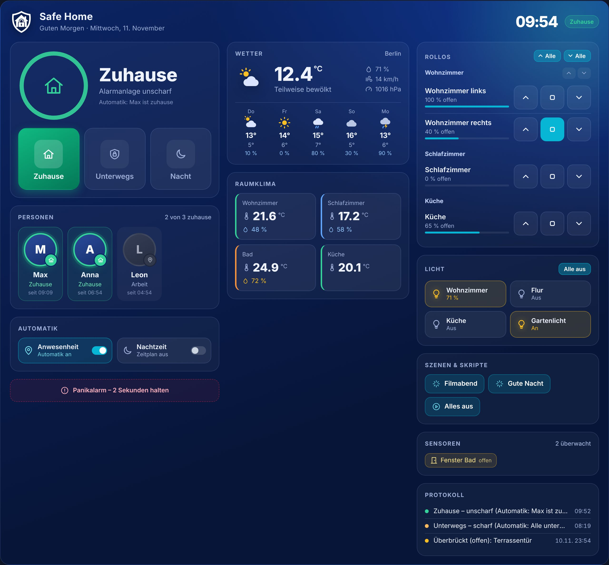</p>

Safe Home macht aus deinen Tür-, Fenster- und Bewegungsmeldern eine vollwertige Alarmanlage. Sie weiß, wer zuhause ist und wie spät es ist, und entscheidet danach selbst, ob sie **Zuhause**, **Unterwegs** oder im **Nachtmodus** ist. Bei einem Alarm gehen Sirene, Licht, Push, Ansage und WhatsApp los – mit deinem eigenen Wortlaut, wenn du willst. Eingerichtet wird alles auf einer eigenen Seite in der Seitenleiste, bedient über sechs Dashboard-Karten.

> **Sprachen:** komplett auf **Deutsch und Englisch** – Einrichtung, Karten, Einstellungsseite, Protokoll, Benachrichtigungen und Ansagen. Karten und Einstellungsseite folgen der Sprache deines Benutzerprofils, Meldungen der Systemsprache (*Einstellungen → System → Allgemein*). Andere Sprachen verwenden Englisch.

---

## Auf einen Blick

| | |
|---|---|
| 🤖 **Autonom** | Scharf, wenn alle weg sind. Unscharf, wenn jemand heimkommt. Nachtmodus nach Uhrzeit – abhängig davon, wer zuhause ist. Oder ein fester Wochenplan. |
| 🚨 **Alarm auf allen Kanälen** | Sirenen, rotes Alarmlicht, kritische Push-Nachricht mit Kamerabild und Entschärfen-Taste, Sprachansage (auch Alexa), WhatsApp mit Eskalation. |
| ✍️ **Dein Wortlaut** | Jede Push-, WhatsApp- und Sprachmeldung lässt sich frei formulieren – mit Platzhaltern und Live-Vorschau. Dazu eigene Namen für jeden Sensor. |
| 🏠 **Teilbereiche & Haushalt** | Bis zu 3 Teilbereiche (Garage, Gartenhaus …) und Haushalts-Melder wie Wassersensoren – unabhängig von der Alarmanlage. |
| 🔐 **PINs für alle** | Ein PIN je Benutzer, Gast-PINs mit Zeitraum, PIN je Bereich, Sperre nach Fehlversuchen. |
| 📱 **Sechs Dashboard-Karten** | Standard, Kompakt, Tablet, Quadrat, Badge und eine Vollbild-Karte mit Wetter, Klima, Rollos, Licht, Kameras und mehr. Bei Alarm wird die ganze Karte rot. |
| ⚙️ **Eigene Einstellungsseite** | Übersichtlich, mit Kurzfassungen, Live-Vorschau, Funktionstest und Empfehlungen. |
| 🎨 **Zwei Designs** | Der eigene Safe-Home-Look oder dein Home-Assistant-Design – dazu ein passendes HA-Design „Safe Home“ fürs ganze System. |

## Galerie

| Standard | Kompakt & Badge | Quadrat |
|---|---|---|
| 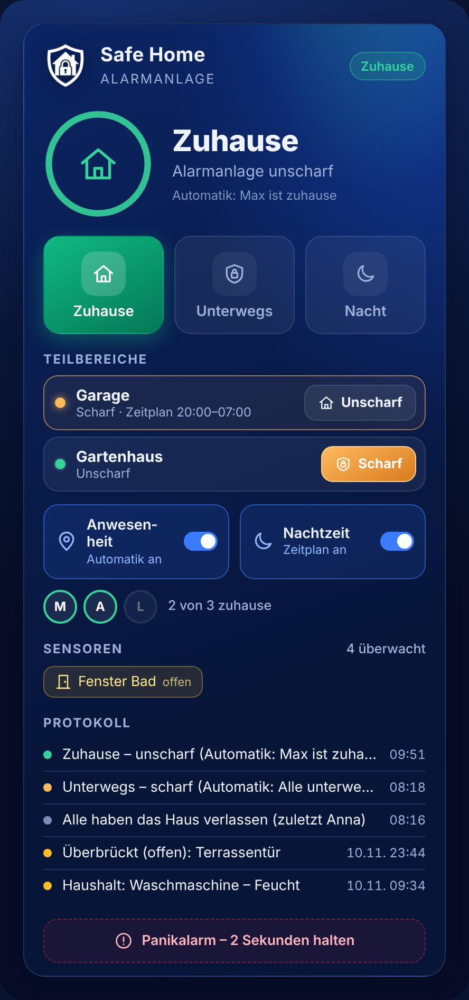 | 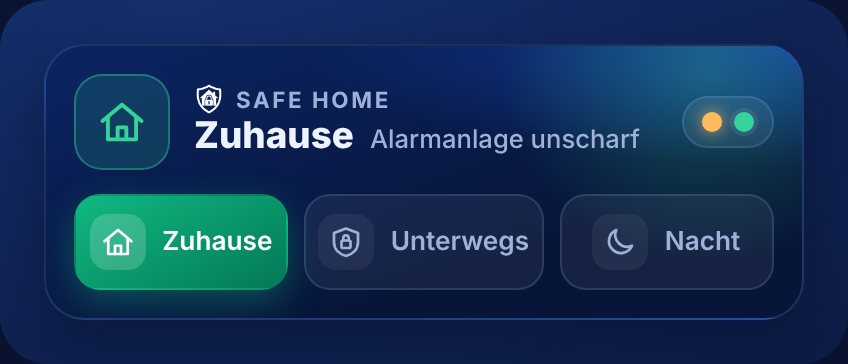<br><br>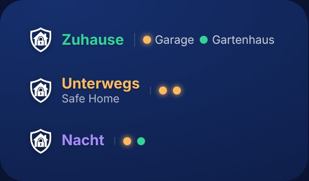 | 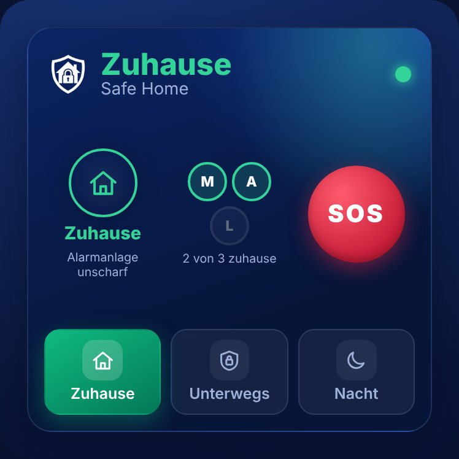 |

| Alarm – die ganze Karte wird rot | Tablet |
|---|---|
| 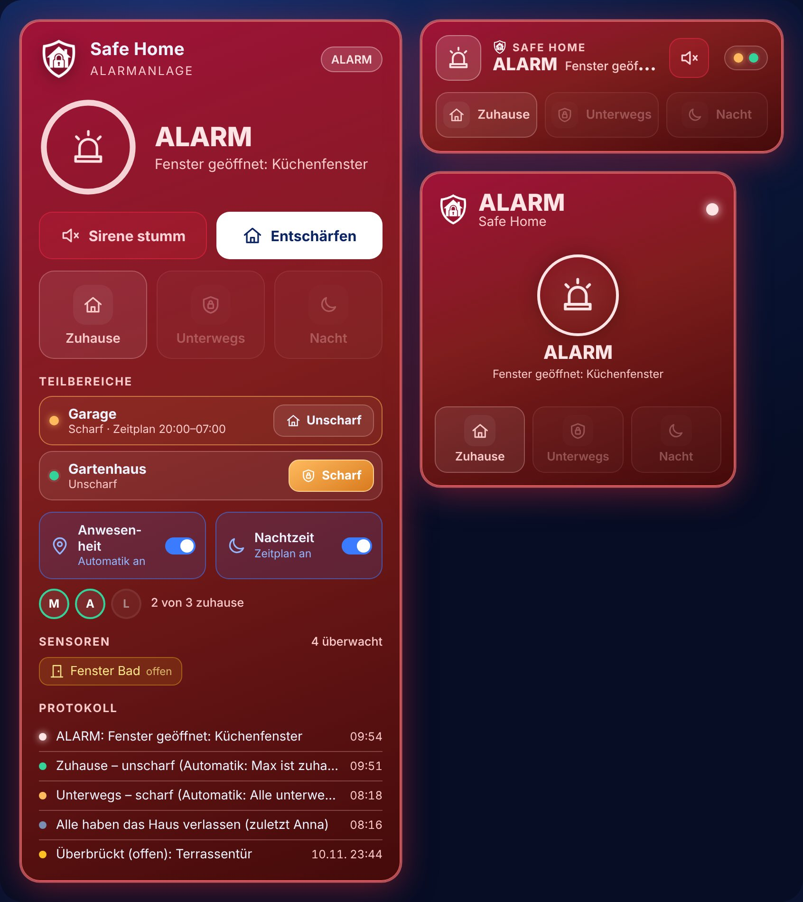 | 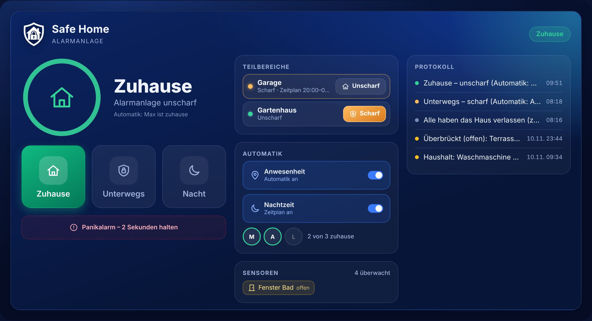 |

| Einstellungsseite | Texte & Vorlagen | Smartphone |
|---|---|---|
| 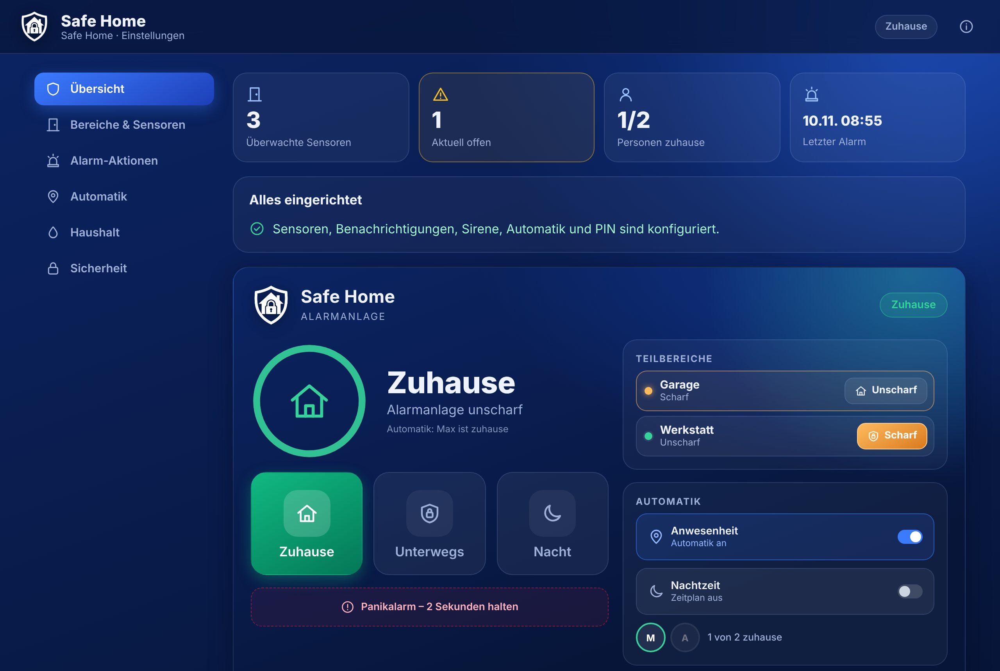 | 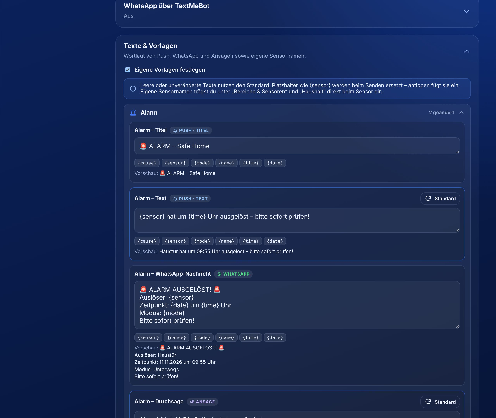 | 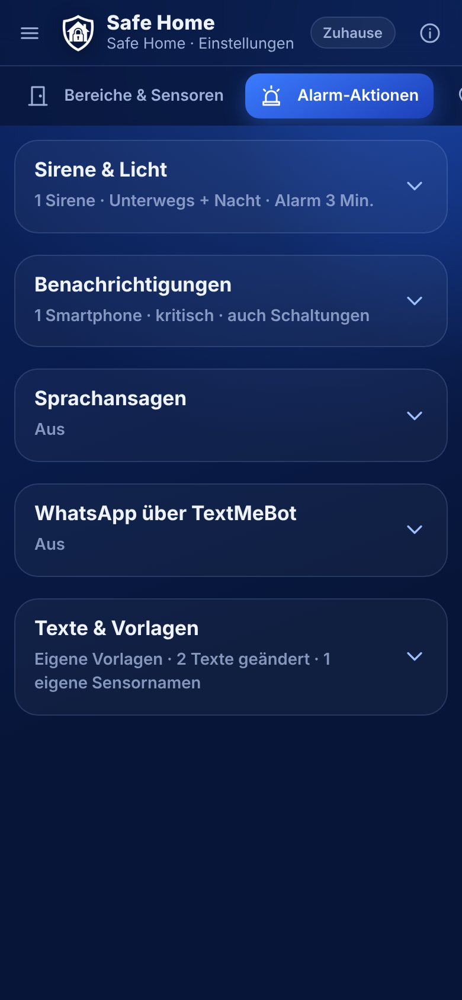 |

## Inhalt

- [Installation & erste Schritte](#installation--erste-schritte)
- [Die Safe-Home-Seite](#die-safe-home-seite)
- [Modi & Automatik](#modi--automatik) – [Tag- und Nacht-Automatik](#tag--und-nacht-automatik), [Wochenplan](#wochenplan), [Verzögerungen & Alarmdauer](#verzögerungen--alarmdauer)
- [Sensoren](#sensoren) – [Art & Ansagen](#art-der-sensoren--ansagen), [Teilbereiche](#teilbereiche), [Haushalt](#haushalt-z-b-wassersensoren), [Batterien](#batterie-überwachung)
- [Bei einem Alarm](#bei-einem-alarm) – [Sirene](#akustischer-alarm), [Push](#push-benachrichtigungen), [Ansagen & Alexa](#sprachansagen--alexa), [WhatsApp](#whatsapp-textmebot), [Texte & Vorlagen](#texte--vorlagen), [Funktionstest](#funktionstest--alarm-von-einem-sensor-auslösen)
- [PINs & Sicherheit](#pins--sicherheit)
- [Dashboard-Karten](#dashboard-karten)
- [Designs](#designs)
- [Für eigene Automationen](#für-eigene-automationen) – Entitäten, Dienste, Ereignisse
- [Fehlerbehebung](#fehlerbehebung)

---

## Installation & erste Schritte

### Über HACS (empfohlen)
1. HACS → ⋮ → **Benutzerdefinierte Repositories** → `https://github.com/digital7even/safe_home`, Kategorie **Integration**.
2. **Safe Home** installieren und Home Assistant neu starten.
3. **Einstellungen → Geräte & Dienste → Integration hinzufügen → Safe Home**.

### Manuell
Den Ordner `custom_components/safe_home` nach `config/custom_components/safe_home` kopieren und Home Assistant neu starten.

> Die Dashboard-Karten werden automatisch geladen und als Dashboard-Ressource eingetragen – du musst nichts von Hand anlegen. Nach einem Update ggf. Browser-Cache leeren bzw. die App neu laden.

### In fünf Minuten startklar
Der Einrichtungsassistent fragt das Nötigste ab (Name & PIN, Sensoren, Verzögerungen, Aktionen, Automatik). Alles Weitere stellst du danach in der Seitenleiste unter **Safe Home** ein:

1. **Bereiche & Sensoren** – *Vorschläge hinzufügen* übernimmt Tür-, Fenster- und Bewegungsmelder mit einem Klick. Je Sensor festlegen: *Unterwegs*, *Nacht*, *Verzögert*.
2. **Alarm-Aktionen** – Sirene wählen und dein Smartphone (Companion App) für Push-Nachrichten anhaken.
3. **Automatik** – Personen für die Home-Zone wählen, Zeiten für den Nachtmodus festlegen.
4. **Sicherheit** – einen PIN für dich anlegen.
5. **Übersicht → Funktionstest** – einmal einen echten Alarm von einem Sensor auslösen und prüfen, ob alles ankommt.

**Tipp:** Haustür mit *Eingangsverzögerung*, Bewegungsmelder **ohne** – so kannst du beim Heimkommen entschärfen, während ein Einbruch über ein Fenster sofort auslöst.

---

## Die Safe-Home-Seite

Nach der Installation erscheint **Safe Home** in der Seitenleiste (nur für Administratoren). Hier stellst du alles ein – im gleichen Design wie die Karten.

| Reiter | Inhalt |
|---|---|
| **Übersicht** | Kennzahlen, Empfehlungen zu Lücken in der Konfiguration, Steuerung der Anlage, **Protokoll** (letzte 5 Ereignisse, auf Wunsch alle 30, filterbar) und **Funktionstest** |
| **Bereiche & Sensoren** | Name der Anlage und bis zu 3 **Teilbereiche**, **Überwachte Sensoren** (Art, Bereich, Modi, eigener Name), **Verzögerungen** als Tabelle mit Live-Ablauf, **Überwachung** (offene/nicht erreichbare Sensoren, Batterien) |
| **Alarm-Aktionen** | **Sirene & Licht**, **Benachrichtigungen**, **Sprachansagen**, **WhatsApp**, **Texte & Vorlagen** |
| **Automatik** | **Anwesenheit**, **Wochenplan**, **Nachtmodus** und – aufklappbar – *Wie arbeitet die Automatik?* |
| **Haushalt** | Haushalts-Melder, **Melden per** Push / WhatsApp / Ansage, Entwarnung |
| **Sicherheit** | **PIN-Eingabe** und **PINs verwalten** |
| **Info** (ⓘ oben rechts) | **Darstellung**, Android-Widget, Status der Dashboard-Ressource, Version, Links |

**Übersichtlich trotz vieler Möglichkeiten:**
- **Kurzfassung:** Zugeklappt zeigt jeder Abschnitt, was eingestellt ist – z. B. *„1 Sirene · Unterwegs + Nacht · Alarm 3 Min.“* oder *„WhatsApp – Aus“*.
- **Erweitert:** Selten genutzte Einstellungen stehen hinter dem Link *Erweitert* im Abschnitt (z. B. Zeitfenster der Sirene, Kamerabild, PIN-Sperre).
- **Info → Darstellung** (je Browser/Gerät): *Einstellungen standardmäßig ausklappen*, *Deaktivierte Unteroptionen ausblenden* (Standard: an – Einstellungen einer ausgeschalteten Funktion bleiben verborgen, bis du sie einschaltest) und *Home-Assistant-Design verwenden* (Beta).

Änderungen gelten erst nach **Speichern** – die Leiste dafür erscheint unten automatisch. Safe Home prüft vorher alle Angaben und markiert Fehler. Bei mehreren Instanzen wählst du oben rechts die gewünschte aus.

### Android-Widget (Companion App)
Unter **Info → Android-Widget** erzeugt Safe Home ein fertiges **Template-Widget** für den Android-Startbildschirm im Stil der Kompakt-Karte: Zustand mit Farbe und Symbol, Hinweiszeile und die drei Modi. Optional mit Personen zuhause, offenen Sensoren und dunkelblauem Hintergrund.

1. **Template kopieren** tippen.
2. Startbildschirm lange gedrückt halten → Widgets → Home Assistant → **Template** auf den Startbildschirm ziehen.
3. Template einfügen und speichern.

Zum Schalten der Modi eignen sich zusätzliche Button-Widgets mit `alarm_control_panel.alarm_arm_away`, `alarm_arm_night` und `alarm_disarm`. Details: [Android-Widgets der Companion App](https://companion.home-assistant.io/docs/integrations/android-widgets).

---

## Modi & Automatik

| Modus | Zustand | Überwacht |
|---|---|---|
| 🏠 **Zuhause** | unscharf | nichts |
| 🛡️ **Unterwegs** | scharf | alle gewählten Sensoren |
| 🌙 **Nacht** | teilweise scharf | nur die Nacht-Sensoren (z. B. Türen und Fenster, keine Bewegungsmelder) |

Die Modi schaltest du auf jeder Karte, per Dienst – oder Safe Home schaltet sie selbst. Die **Home-Zone-Automatik** („Anwesenheit“) und der **Nachtmodus nach Zeitplan** („Nachtzeit“) haben je einen Schalter auf den Karten und im Reiter *Automatik*; er wirkt sofort, ohne Speichern.

### Tag- und Nacht-Automatik

| Situation | Safe Home |
|---|---|
| Letzte Person verlässt die Home-Zone | Nach der Wartezeit **Unterwegs** – auch direkt aus dem Nachtmodus. |
| Erste Person kommt heim | **Unterwegs aus** – auch während der Eingangsverzögerung oder eines Alarms. Ist Nachtzeit, nach der Wartezeit (Standard 10 Min.) wieder **Nachtmodus**. |
| **Nachtbeginn**, jemand ist zuhause | **Nachtmodus**. War Unterwegs automatisch aktiv, wird gewechselt. |
| **Nachtbeginn**, niemand zuhause | **Kein Nachtmodus** – Unterwegs bleibt aktiv bzw. wird eingeschaltet. |
| Jemand kommt **nachts** heim | Kurz unscharf, nach der Wartezeit wieder Nachtmodus (*Nach Heimkehr in der Nacht wieder Nachtmodus nach … Minuten*, 0 = bleibt unscharf). |
| **Nachtende**, jemand zuhause | Unscharf („Guten Morgen“). |
| **Nachtende**, niemand mehr da | Nicht unscharf, sondern **Unterwegs** – das leere Haus bleibt geschützt. |

- Personenabhängige Schritte gelten nur bei eingeschalteter Home-Zone-Automatik. Ohne sie schaltet Safe Home nur nach Zeitplan und schaltet ein leeres Haus morgens nie unscharf.
- **Von Hand gewähltes Unterwegs** wird von der Automatik nie überschrieben.
- Auf der Seite zeigt *Automatik → Wie arbeitet die Automatik?* diese Regeln mit deinen aktuellen Zeiten.

### Wochenplan
Unter **Automatik → Wochenplan** zeichnest du feste Scharf-Zeiten je Wochentag: Balken für **Unterwegs** (orange) oder **Nacht** (lila) per Ziehen eintragen; außerhalb der Balken ist die Anlage **unscharf**. Ränder ziehen ändert die Zeit, den Balken ziehen verschiebt ihn, *Unscharf* radiert. Raster: 15 Minuten. *Montag auf Di–Fr kopieren* und *Alles leeren* helfen beim Einrichten.

- Nur aktiv, wenn **„Anwesenheit“ ausgeschaltet** ist.
- Zum Beginn eines Balkens wird scharf geschaltet (mit Ausgangsverzögerung), zum Ende unscharf – aber nur, wenn der Wochenplan geschaltet hat. Handbetrieb und laufende Alarme bleiben unangetastet.
- Balken über Mitternacht (z. B. Di 22–24 Uhr und Mi 0–6 Uhr) gelten als ein Zeitraum.
- Solange der Wochenplan aktiv ist, pausiert der Nachtmodus-Zeitplan – beide überschneiden sich nie.

### Verzögerungen & Alarmdauer
- **Ausgangs- und Eingangsverzögerung** getrennt für Unterwegs und Nacht – auf der Seite als kompakte Tabelle mit Live-Ablauf darunter. Die Ausgangsverzögerung lässt sich auf jeder Karte mit **„Sofort scharf schalten“** überspringen.
- Nur Sensoren mit *Verzögert* (z. B. Haustür) starten den Countdown. Schließen der Tür beendet ihn nicht – nur Entschärfen. Meldet währenddessen ein Sensor **ohne** Verzögerung (z. B. Bewegung im Wohnzimmer), beginnt der Alarm **sofort**.

| Einstellung | Bedeutung |
|---|---|
| **Alarmdauer** | So lange bleibt der Alarm aktiv; danach wieder scharf (falls *danach wieder scharf* an ist), sonst bis zum Ausschalten. `0` = bis zum Ausschalten. |
| **Sirenendauer** | So lange ertönt die Sirene; danach bleibt der Alarm **still** bestehen – Push, WhatsApp und Licht laufen weiter. `0` = während der gesamten Alarmdauer. |

Beispiel: Alarm 10 Min., Sirene 3 Min. → 3 Minuten Sirene, 7 Minuten stiller Alarm, danach wieder scharf.

---

## Sensoren

### Art der Sensoren & Ansagen
Für jeden Sensor wählst du die **Art** – **Türkontakt, Fensterkontakt, Bewegungsmelder, Präsenzmelder, Wassersensor oder Kamera**. Safe Home schlägt sie anhand der Geräteklasse vor. Die Art bestimmt den Wortlaut aller Meldungen:

| Art | Push / WhatsApp / Protokoll | Ansage |
|---|---|---|
| Türkontakt | Tür geöffnet: Haustür | Achtung, möglicher Einbruch! Geöffnete Tür erkannt: Haustür. |
| Fensterkontakt | Fenster geöffnet: Küche | Achtung, möglicher Einbruch! Geöffnetes Fenster erkannt: Küche. |
| Bewegungsmelder | Bewegung erkannt: Flur | Achtung, möglicher Einbruch! Bewegung erkannt: Flur. |
| Präsenzmelder | Anwesenheit erkannt: Wohnzimmer | Achtung, möglicher Einbruch! Person erkannt: Wohnzimmer. |
| Kamera | Kamera hat Bewegung erkannt: Einfahrt | Achtung, möglicher Einbruch! Bewegung auf der Kamera erkannt: Einfahrt. |
| Wassersensor | Wasser erkannt: Keller | Achtung, Wasseralarm! Wasser erkannt: Keller. |

Alle diese Texte und die Sensornamen lassen sich unter [Texte & Vorlagen](#texte--vorlagen) anpassen.

**Weitere Schutzfunktionen**
- **Offene Fenster beim Scharfschalten:** überbrücken und melden oder Scharfschalten verhindern. Ein überbrückter Sensor wird wieder überwacht, sobald er geschlossen ist.
- **Sabotage/Funkverlust:** Meldung, wenn ein Sensor im scharfen Zustand nicht mehr erreichbar ist.
- **Kein Fehlalarm nach Neustarts:** nur echte Wechsel von „zu“ auf „offen“ lösen aus. Zustand und Protokoll überstehen Neustarts.

### Teilbereiche
Neben dem **Hauptbereich** (Zuhause / Unterwegs / Nacht) legst du unter *Bereiche & Sensoren* bis zu **3 Teilbereiche** an, z. B. *Garage*, *Gartenhaus* oder *Werkstatt*. Ein Teilbereich kennt nur **Scharf** und **Unscharf** und bekommt eine eigene Entität `alarm_control_panel.<name>`.

| Einstellung | Beschreibung |
|---|---|
| **Name** | Steht in den Karten und in jeder Meldung (Push, WhatsApp, Ansage, Protokoll) |
| **Sensoren** | In der Sensortabelle je Sensor den **Bereich** wählen – jeder Sensor gehört genau einem Bereich |
| **Sirene** | *Wie Hauptbereich*, *Eigene Sirenen* (z. B. nur die Außensirene) oder *Keine Sirene* |
| **Verzögerungen** | Eigene Ausgangs-/Eingangsverzögerung, *Verzögert* je Sensor |
| **Kernzeiten** | Zur Startzeit an gewählten Wochentagen scharf, zur Endzeit unscharf (z. B. 18:30–06:00, Mo–Fr) |
| **Eigene Anwesenheit** | Scharf, wenn alle gewählten Personen weg sind; unscharf, sobald eine zurückkommt |

Alarme laufen über dieselben Ausgänge wie beim Hauptbereich – immer mit dem Namen des Bereichs, z. B. *„🚨 ALARM – Garage“*. In den Karten erscheinen Teilbereiche als Liste oder Punkte; ein Alarm im Teilbereich färbt die ganze Karte rot und zeigt ein Banner mit Entschärfen-Knopf.

### Haushalt (z. B. Wassersensoren)
Im Reiter **Haushalt** bindest du Melder ein, die **unabhängig von der Alarmanlage** überwacht werden – auch im Modus Zuhause. Sie lösen keine Sirene aus, sondern melden sich per **Push**, **WhatsApp** und/oder **Ansage**.

- Je Sensor wählst du **„Melden bei“** – z. B. *Feucht* bei einem Wassersensor. Auch andere Entitäten gehen (z. B. `sensor.trockner_status` = `fertig`).
- **Vorschläge:** alle Wassersensoren mit einem Klick. **Entwarnung** („Waschmaschine ist wieder trocken“) optional.
- Meldende Sensoren erscheinen auf den Karten (💧) und im Protokoll; für Automationen gibt es das Attribut `household_alerts`.

### Batterie-Überwachung
Safe Home prüft die Batterien aller überwachten Sensoren (Batterie-Entität desselben Geräts oder Attribut `battery_level`). Unter der Schwelle (Standard **20 %**, einstellbar 5–90 %) erscheint ein gelber Chip auf den Karten, ein Protokolleintrag und – wenn gewünscht – eine Push-Nachricht. Jede Batterie wird nur einmal gemeldet, bis sie gewechselt wurde (5 % über der Schwelle).

---

## Bei einem Alarm

| Kanal | Was passiert |
|---|---|
| 🔊 **Sirene** | `siren`, `switch`, `input_boolean` oder `script` – fein einstellbar nach Modus, Zeitfenster und Sensor |
| 💡 **Alarmlicht** | Gewählte Lampen leuchten rot und werden beim Entschärfen zurückgesetzt |
| 📱 **Push** | Companion App, auf Wunsch **kritisch** (umgeht Lautlos), mit **Kamerabild** und Tasten *Sirene stumm* / *Entschärfen* |
| 🗣️ **Ansage** | Über Lautsprecher (TTS) und/oder Alexa – passend zur Art des Melders |
| 💬 **WhatsApp** | Über TextMeBot, mit Eskalation an weitere Empfänger und Entwarnung |
| 🖥️ **Karten** | Die ganze Karte färbt sich rot und pulsiert – beim Entschärfen ist alles wieder normal |
| ⚙️ **Automationen** | Ereignis `safe_home_triggered`, persistente Benachrichtigung in Home Assistant |

### Akustischer Alarm
Unter **Alarm-Aktionen → Sirene & Licht** legst du fest, wann die Sirene ertönt. Eine Zeile fasst die Einstellung zusammen, z. B. *„Sirene ertönt: Unterwegs + Nacht · von 22:00 bis 06:00 Uhr – 4 von 5 Sensoren lösen die Sirene aus“*.

| Einstellung | Bedeutung |
|---|---|
| **Sirene im Modus** | *Unterwegs* und/oder *Nacht* (Standard: beide) |
| **Zeitfenster** (*Erweitert*) | Von–bis, auch über Mitternacht. Standard: rund um die Uhr |
| **Sirene je Sensor** (*Erweitert*) | Je Sensor *Sirene* oder *Still*, dazu *Alle an* / *Alle still* |

Greift eine Regel, gibt es einen **stillen Alarm**: Push, WhatsApp, Licht (und standardmäßig die Ansage) laufen, nur die Sirene bleibt aus; das Protokoll nennt den Grund. Löst währenddessen ein Sensor aus, der die Sirene darf, startet sie nachträglich. **Panikalarm** und manuelles Auslösen ertönen immer.

### Push-Benachrichtigungen
Unter **Alarm-Aktionen → Benachrichtigungen** wählst du die Smartphones mit Companion App. Optionen: *Kritisch – klingelt auch bei Lautlos*, *auch bei Schaltungen*, unter *Erweitert* die Taste *Entschärfen* (mit Geräte-Entsperrung) und das Kamerabild.

### Sprachansagen & Alexa
Unter **Alarm-Aktionen → Sprachansagen** wählst du Sprachausgabe-Dienst und Lautsprecher. Zusätzlich:
- **Ansage während der Eingangsverzögerung** – *„Bitte Alarmanlage innerhalb von 30 Sekunden ausschalten.“*, in Schleife mit der Restzeit (Standard alle 10 s, 0 = nur einmal).
- **Ansage bei Haushalts-Alarm** und **Ansage auch bei stillem Alarm**.
- **Alexa-Geräte** ([Alexa Media Player](https://github.com/alandtse/alexa_media_player)): erst mit der Checkbox *Alexa-Geräte verwenden* wählbar; sie sprechen mit der normalen Alexa-Stimme, ganz ohne Sprachausgabe-Dienst.

### WhatsApp (TextMeBot)
Safe Home schickt Alarme direkt per WhatsApp – ohne Automation. Einstellen unter **Alarm-Aktionen → WhatsApp über TextMeBot**.

> **Wichtig:** [TextMeBot](https://textmebot.com) ist ein **kostenpflichtiges Angebot eines Drittanbieters** (nicht von Safe Home, Home Assistant oder WhatsApp). Es gibt keine Zustellgarantie – nutze WhatsApp nur zusätzlich zu Push und Sirene. Telefonnummern und Texte werden an TextMeBot übermittelt.

| Einstellung | Bedeutung |
|---|---|
| **Empfänger** | Name, WhatsApp-Nummer (international, z. B. `+491701234567`, oder Gruppen-ID) und TextMeBot-API-Key. Bis zu 10, jeder mit Häkchen **Aktiv** |
| **Senden: sofort / nach X Min.** | Mit Wartezeit = **Eskalation**: nur, wenn der Alarm bis dahin nicht ausgeschaltet wurde |
| **Entwarnung** | Wer eine Alarm-Nachricht bekam, erhält beim Ausschalten „✅ Entwarnung …“ |
| **Weitere Meldungen** | Optional auch Schaltungen, Sabotage und falscher PIN (an Empfänger mit „sofort“) |

Den Wortlaut der Nachrichten legst du unter [Texte & Vorlagen](#texte--vorlagen) fest. An die vorausgefüllten Beispieldaten wird nie gesendet. Lieber als Automation? Siehe [`docs/automation-whatsapp.yaml`](docs/automation-whatsapp.yaml) – bitte nur eine der beiden Varianten verwenden.

### Texte & Vorlagen
Unter **Alarm-Aktionen → Texte & Vorlagen** bestimmst du den Wortlaut selbst. Aktiviere dazu **Eigene Vorlagen festlegen** – ohne Häkchen gelten die eingebauten Texte und die Namen aus Home Assistant.

<p align="center"></p>

- **47 Vorlagen in sechs Gruppen:** *Alarm*, *Eingangsverzögerung*, *Scharf & unscharf*, *Hinweise*, *Haushalt* und *Texte je Melder-Art*. Jede ist als **Push · Titel**, **Push · Text**, **WhatsApp**, **Ansage** oder **Auslöser** gekennzeichnet.
- **Vorausgefüllt mit dem Standard:** Jedes Feld zeigt den aktuellen Text. Leere oder unveränderte Texte nutzen weiter den Standard; **Standard** setzt ein Feld zurück, *Alle Texte auf Standard* alles.
- **Platzhalter** wie `{sensor}`, `{cause}`, `{mode}`, `{zone}`, `{time}`, `{date}` oder `{name}` – antippen fügt sie ein, ein Tooltip erklärt sie. Unbekannte Platzhalter bleiben einfach stehen.
- **Live-Vorschau** unter jedem Feld mit Beispielwerten.
- **Eigene Sensornamen:** Mit eingeschalteten Vorlagen bekommt jeder Sensor unter *Bereiche & Sensoren* und *Haushalt* ein Feld *Eigener Name*. Er wird in Push, WhatsApp, Ansagen, Protokoll und auf allen Dashboard-Karten verwendet – ist keiner gesetzt, der Name aus Home Assistant.

Beispiel: *Alarm – Text* = `{sensor} hat um {time} Uhr ausgelöst – bitte sofort prüfen!` → *„Eingang vorne hat um 21:47 Uhr ausgelöst – bitte sofort prüfen!“*

### Funktionstest & Alarm von einem Sensor auslösen
Unter **Übersicht → Funktionstest** prüfst du einzelne Ausgänge (Benachrichtigung, Sirene 3 s, Alarmlicht 5 s, Ansage, WhatsApp) – oder löst einen **echten Alarm von einem Sensor** aus:

1. **Alarmanlage** (Haupt- und Teilbereiche) oder **Haushalt** wählen, Sensor auswählen.
2. **Alarm auslösen** – mit einem zweiten Klick bestätigen.
3. Sirenen, Licht, Ansage, Push und WhatsApp laufen **genau wie im Ernstfall**, mit dem echten Wortlaut – das Wort „Test“ taucht nirgends auf.
4. **Rückstellung** beendet alles und stellt den Zustand davor wieder her.

Sag vorher Mitbewohnern und WhatsApp-Empfängern Bescheid.

---

## PINs & Sicherheit

Unter **Sicherheit** bekommt jeder Home-Assistant-Benutzer einen **eigenen PIN**; dazu kommen **Gast-PINs**, z. B. für Handwerker oder Feriengäste.

| | |
|---|---|
| **Benutzer-PINs** | Ein PIN je Benutzer. 🎲 erzeugt einen zufälligen 6-stelligen PIN, 👁 zeigt ihn an. |
| **Gast-PINs** | Name, PIN, **Gültig ab** / **Gültig bis** (optional), per Häkchen deaktivierbar. Status: *Aktiv*, *Geplant*, *Abgelaufen*, *Deaktiviert*, *Unbegrenzt*. |

- **PIN-Funktion an/aus** – Hauptschalter unter *PIN-Eingabe*.
- **Je Bereich:** *PIN verlangen für* Hauptbereich und jeden Teilbereich einzeln. Ein Bereich ohne Haken oder ohne zugeordneten PIN ist ohne PIN bedienbar.
- **Je PIN:** *Darf schalten* – z. B. der Handwerker nur *Garage*.
- **Sirene stumm schalten** braucht ebenfalls den PIN (abschaltbar) – ein Einbrecher am Wand-Tablet kann sie nicht abschalten. Automationen mit `safe_home.silence` brauchen keinen.
- **Sperre nach falschen PINs:** nach 5 Fehlversuchen (einstellbar) 5 Minuten gesperrt, mit kritischer Push-Nachricht. Übersteht Neustarts.
- Protokoll und Meldungen nennen, wessen PIN verwendet wurde. PINs sind mindestens 4 Zeichen lang und eindeutig.
- **Panikalarm:** Taste in der Karte 2 Sekunden halten oder Dienst `safe_home.panic`.

---

## Dashboard-Karten

Sechs Varianten, alle unter **Karte hinzufügen** zu finden. Bei einem Alarm – im Hauptbereich oder einem Teilbereich – färbt sich bei allen Karten **der ganze Hintergrund rot**; beim Entschärfen ist alles wieder normal.

| Karte | Typ | Wofür |
|---|---|---|
| **Standard** | `custom:safe-home-card` | Alle Infos untereinander |
| **Kompakt** | `custom:safe-home-compact-card` | Nur Status (mit Countdown) und die drei Modi |
| **Tablet** | `custom:safe-home-tablet-card` | Alle Infos, ein- bis dreispaltig je nach Breite, große Tasten |
| **Quadrat** | `custom:safe-home-square-card` | 1:1 für kleine Wand-Displays: Status, Modi, runde SOS-Taste |
| **Badge** | `custom:safe-home-badge-card` / `custom:safe-home-badge` | Logo und Status, transparent – auch als echtes Dashboard-Badge |
| **Custom** | `custom:safe-home-custom-card` | Vollbild für Smartphone & Tablet mit vielen Modulen |

```yaml
type: custom:safe-home-card
entity: alarm_control_panel.safe_home
```

### Optionen (alle Varianten)
```yaml
title: Mein Zuhause      # optional
layout: standard        # standard | compact | tablet | custom
show_automation: true   # Home-Zone- & Nacht-Automatik, Personen
show_sensors: true      # offene / überbrückte Sensoren
show_events: true       # Protokoll
events_count: 5         # Tablet: Standard 8
show_panic: true        # Panik-Taste (2 s halten)
zones_display: inline   # Tablet & Custom: inline | dots | hidden
background_color: [20, 110, 70]   # eigene Hintergrundfarbe (Rot, Grün, Blau)
```
Ist ein PIN nötig, öffnet sich ein Ziffernblock. Die **Hintergrundfarbe** stellst du im Karten-Editor mit drei Reglern ein – Flächen, Schrift und Akzent werden passend abgeleitet.

### Quadrat
```yaml
type: custom:safe-home-square-card
entity: alarm_control_panel.safe_home
show_panic: true        # runde SOS-Taste (2 s halten)
square_status: false    # aktueller Modus, groß
square_persons: false   # Personen zuhause / unterwegs
square_view: all        # all = eine Ansicht, swipe = wischen
```

### Badge
```yaml
type: custom:safe-home-badge-card
entity: alarm_control_panel.safe_home
show_zones: true      # Teilbereiche als Punkte
zone_names: false     # Namen neben den Punkten
show_name: false      # Name der Anlage unter dem Status
red_logo: false       # rotes statt weißes Logo (für helle Hintergründe)
```

### Custom – Vollbild für Smartphone & Tablet
Alles aus dem Standard-Layout plus Module, die sich im Editor einzeln ein- und ausschalten, per Drag & Drop anordnen und in vier Größen skalieren lassen.

| Smartphone | Tablet |
|---|---|
| 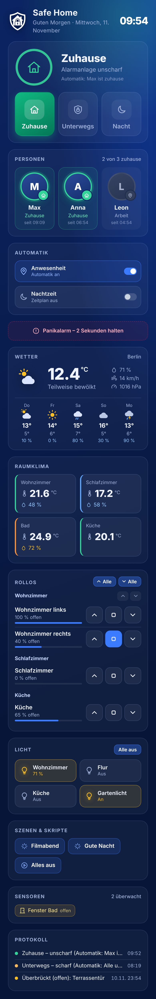 |  |

| Modul | Was es zeigt |
|---|---|
| **Uhr & Begrüßung** | Große Uhrzeit, „Guten Morgen/Tag/Abend“ und Datum |
| **Personen** | Profilbilder mit *Zuhause*, *Unterwegs* oder Zonenname und seit wann |
| **Wetter** | Temperatur, Zustand, Luftfeuchte, Wind, Luftdruck, Vorhersage (2–8 Einträge) |
| **Raumklima** | Thermometer und Luftfeuchte je Raum, farbig nach Temperatur |
| **Rollos** | Hoch / Stopp / Runter, nach Räumen gruppiert – klassisch oder als animiertes Rollo |
| **Licht** | Lampen und Schalter als Kacheln, mit Helligkeit und „Alle aus“ |
| **Szenen & Skripte** | Ein Tipp startet sie |
| **Kameras** | Live-Standbilder, automatisch aktualisiert |
| **Kraftstoffpreise** | Bis zu 4 Tankstellen (z. B. Tankerkönig), günstigste geöffnete grün markiert |
| **Eigene Widgets 1–4** | Beliebige Dashboard-Karten als YAML – auch HACS-Karten |
| **Alarmanlage** | Automatik-Schalter, offene Sensoren, Protokoll, Panik-Taste |

<details>
<summary><b>Alle Optionen der Custom-Karte</b></summary>

```yaml
type: custom:safe-home-custom-card
entity: alarm_control_panel.safe_home
device: auto            # auto | phone | tablet
fullscreen: true        # füllt den Bildschirm – am besten in einer Panel-Ansicht
accent: auto            # auto | blue | indigo | cyan | emerald | amber | red
show_clock: true
show_people: true
people: []              # leer = Personen aus der Alarmanlage
show_weather: true
weather_entity: weather.forecast_home
show_forecast: true
forecast_days: 5
show_climate: true
climate_entities: [sensor.wohnzimmer_temperatur, sensor.wohnzimmer_luftfeuchtigkeit]
show_covers: true
cover_entities: [cover.wohnzimmer, cover.schlafzimmer]
covers_group_by_area: true
covers_design: animated # classic | animated
show_lights: true
light_entities: [light.wohnzimmer]
show_scenes: true
scene_entities: [scene.filmabend]
show_cameras: true
camera_entities: [camera.einfahrt]
camera_refresh: 10      # Sekunden
show_fuel: true
fuel_entities: [sensor.aral_hauptstrasse_super_e10]
fuel_sort: false        # true = günstigste zuerst
show_custom_1: true     # eigene Widgets 1–4
custom_1_title: Energie
custom_1_card:
  type: entities
  entities: [sensor.stromverbrauch]
widget_sizes:           # xs | s | m | l – per − / + im Editor
  cameras: s
layout_order:           # wird per Drag & Drop gesetzt
  a: [alarm, people, automation, panic]
  b: [weather, climate, fuel, cameras, custom1]
  c: [covers, lights, scenes, sensors, events]
```
</details>

**Anordnen:** im Karten-Editor unter *Anordnung* per Drag & Drop oder direkt im Dashboard (Bearbeiten) über die Griffleiste jedes Widgets. Auf dem Smartphone stehen die Spalten untereinander.

---

## Designs

### Home-Assistant-Design (Beta)
Unter **Info → Darstellung → Home-Assistant-Design verwenden** <sup>(Beta)</sup> übernehmen die Safe-Home-Seite **und alle Karten** die Farben deines aktiven HA-Designs (hell oder dunkel) – hilfreich bei Darstellungsproblemen mit eigenen Themes. Die Zustandsfarben bleiben, auf hellem Hintergrund erscheint das rote Logo. Gilt nach dem Speichern auf allen Geräten.

### Design „Safe Home“ für ganz Home Assistant
Safe Home bringt ein eigenes HA-Design mit hellem und dunklem Modus mit – es wird beim Start automatisch hinzugefügt. Auswählen unter **Profil → Design → Safe Home**, auch für einzelne Dashboards. Nach *Designs neu laden* ist es weiterhin verfügbar.

---

## Für eigene Automationen

### Entitäten
| Entität | Beschreibung |
|---|---|
| `alarm_control_panel.safe_home` | Die Alarmanlage (Zuhause / Unterwegs / Nacht) |
| `alarm_control_panel.<teilbereich>` | Je Teilbereich eine (Scharf / Unscharf) |
| `switch.safe_home_anwesenheits_automatik` | Home-Zone-Automatik ein/aus |
| `switch.safe_home_nacht_automatik` | Nachtmodus-Zeitplan ein/aus |
| `binary_sensor.safe_home_offene_sensoren` | An, wenn ein überwachter Sensor offen ist |
| `binary_sensor.safe_home_sirene_aktiv` | An, solange die Sirene läuft |
| `sensor.safe_home_letztes_ereignis` | Letzter Protokolleintrag |
| `sensor.safe_home_letzter_alarm` | Zeitpunkt des letzten Alarms |
| `sensor.safe_home_personen_zuhause` | Anzahl Personen zuhause |

*(Die genauen IDs hängen von Name und Sprache ab.)* Nützliche Attribute der Alarmanlage: `triggered_sensors`, `silent_alarm`, `silent_reason`, `household_alerts`, `zones`, `sensor_names`.

### Dienste
| Dienst | Beschreibung |
|---|---|
| `alarm_control_panel.alarm_disarm / alarm_arm_away / alarm_arm_night` | Standard-Dienste von Home Assistant |
| `safe_home.panic` | Sofortalarm |
| `safe_home.silence` | Sirenen aus, Alarm bleibt bestehen (optional `code`) |
| `safe_home.skip_exit_delay` | Laufende Ausgangsverzögerung überspringen (auch Teilbereiche) |
| `safe_home.set_auto_mode` | Automatiken schalten (`enabled`, optional `night`) |

### Ereignisse
- `safe_home_triggered` – `cause`, `mode`, `name` (Teilbereiche: `mode: zone`, dazu `zone` und `zone_id`)
- `safe_home_state_changed` – `state`, `mode`, `changed_by`

```yaml
# Beispiel: Bei Alarm alle Rollläden hochfahren
trigger:
  - platform: event
    event_type: safe_home_triggered
action:
  - service: cover.open_cover
    target:
      area_id: erdgeschoss
```

---

## Fehlerbehebung

**„Konfigurationsfehler“ nach dem Start der App / Karten fehlen:** Safe Home liefert die Karten wie eine HACS-Karte aus – die Datei liegt in `config/www/safe_home/` und ist als **Dashboard-Ressource** eingetragen (`/local/safe_home/safe-home-card.js`). Gab es den Ordner `www` vorher nicht, Home Assistant **einmal zusätzlich neu starten**. Den Status zeigt **Info** (ⓘ); bei einem Problem erscheint dort *Jetzt eintragen*.

**Dashboards/Ressourcen im YAML-Modus:** Ressource bitte selbst ergänzen:
```yaml
lovelace:
  resources:
    - url: /local/safe_home/safe-home-card.js
      type: module
```

**„Custom element doesn't exist: safe-home-…“:** Safe Home meldet seine Karten auch dann richtig an, wenn andere Karten das Element-Verzeichnis austauschen. Tritt die Meldung trotzdem auf, bitte die Build-Kennung aus dem Karten-Editor und einen Screenshot der Browser-Konsole (F12) in einem [Issue](https://github.com/digital7even/safe_home/issues) posten.

**Gerät springt ständig zur Anmeldeseite** (z. B. Fully Kiosk): Start-URL auf das Dashboard setzen, Web-Speicher erlauben und das Leeren von Cache/Cookies beim Neuladen ausschalten.

**Eigene Texte erscheinen nicht:** Prüfen, ob *Eigene Vorlagen festlegen* angehakt und gespeichert ist. Ein Text, der genau dem Standard entspricht, wird nicht gespeichert.

---

## Hinweis

Safe Home ist eine Software-Alarmanlage auf Basis von Home Assistant. Sie ersetzt keine zertifizierte Einbruchmeldeanlage mit Notstromversorgung und Aufschaltung auf einen Wachdienst. Für maximale Zuverlässigkeit empfiehlt sich eine USV für den Home-Assistant-Server und das Funk-Gateway.

---

<p align="center">
  Dieses Projekt wurde mit ❤️ entwickelt in Deutschland.<br>
  Danke, dass du <b>Safe Home</b> nutzt!<br><br>
  <a href="https://github.com/digital7even"><b>Digital7even</b></a>
</p>
