<p align="center">
  
</p>

<h1 align="center">Safe Home</h1>
<p align="center"><b>Your autonomous alarm system for Home Assistant</b><br>
Arms and disarms itself, alerts you on every channel – and looks good doing it.</p>

<p align="center">
  
  
  
</p>

<p align="center"><b>English</b> · <a href="README.de.md">Deutsch</a> · <a href="CHANGELOG.md">Release notes</a></p>

<p align="center">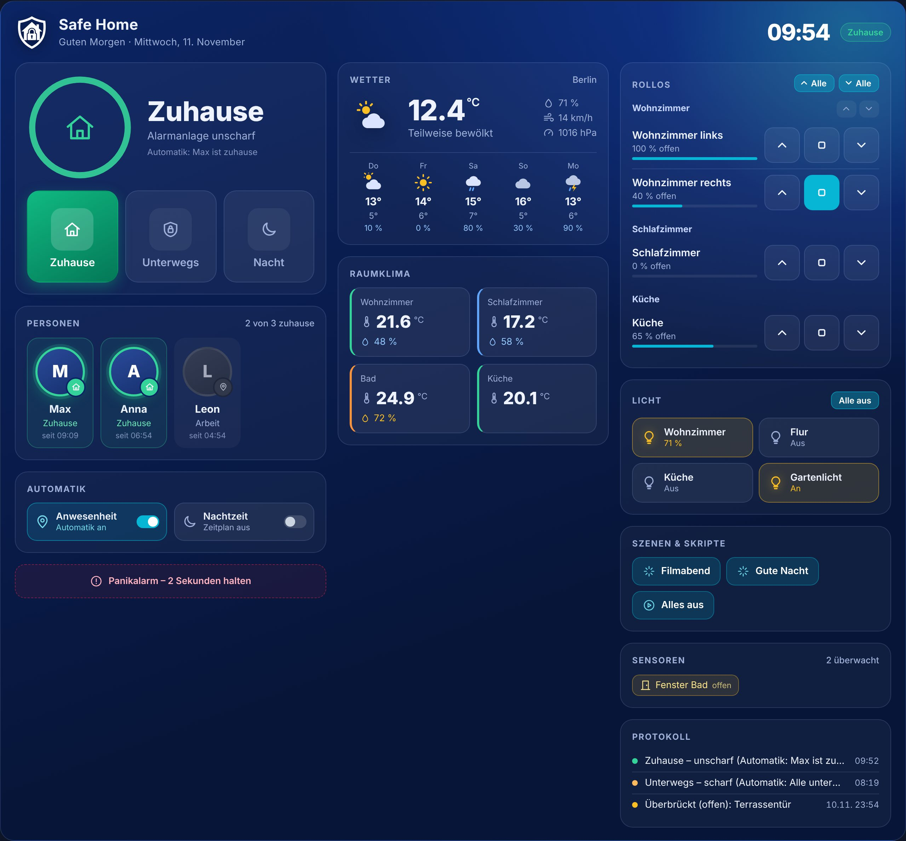</p>

Safe Home turns your door, window and motion sensors into a full alarm system. It knows who is home and what time it is, and decides on its own whether it is in **Home**, **Away** or **Night** mode. When an alarm goes off, siren, lights, push, announcement and WhatsApp kick in – in your own words if you like. Everything is set up on its own page in the sidebar and operated with six dashboard cards.

> **Languages:** fully available in **English and German** – setup, cards, settings page, log, notifications and announcements. Cards and the settings page follow your user profile language; messages follow the system language (*Settings → System → General*). Other languages use English. The screenshots show the German interface.

---

## At a glance

| | |
|---|---|
| 🤖 **Autonomous** | Armed when everyone has left. Disarmed when someone comes home. Night mode by time – depending on who is home. Or a fixed weekly schedule. |
| 🚨 **Alarm on every channel** | Sirens, red alarm lights, critical push with camera snapshot and disarm button, announcement (Alexa too), WhatsApp with escalation. |
| ✍️ **Your wording** | Every push, WhatsApp and spoken message can be written freely – with placeholders and live preview. Plus custom names for every sensor. |
| 🏠 **Partitions & household** | Up to 3 partitions (garage, garden shed …) and household sensors such as water sensors – independent of the alarm system. |
| 🔐 **PINs for everyone** | One PIN per user, guest PINs with a validity period, PIN per area, lock after wrong attempts. |
| 📱 **Six dashboard cards** | Standard, compact, tablet, square, badge and a full-screen card with weather, climate, covers, lights, cameras and more. During an alarm the whole card turns red. |
| ⚙️ **Dedicated settings page** | Tidy, with summaries, live preview, function test and recommendations. |
| 🎨 **Two designs** | The Safe Home look or your Home Assistant theme – plus a matching HA theme "Safe Home" for the whole system. |

## Gallery

| Standard | Compact & badge | Square |
|---|---|---|
| 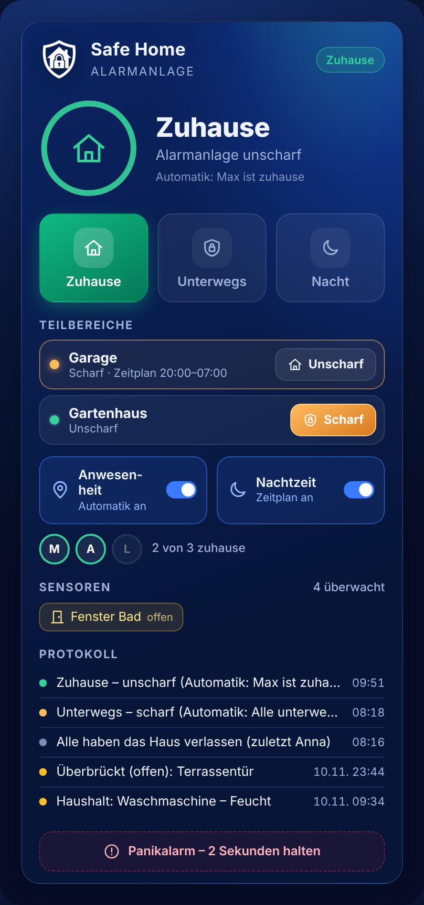 | 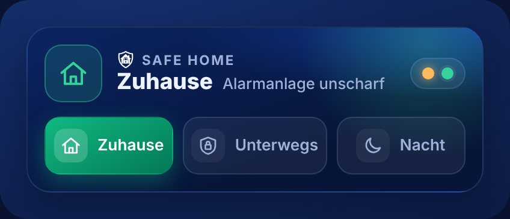<br><br>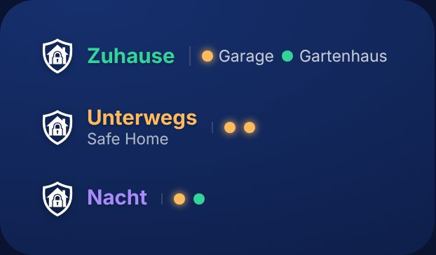 | 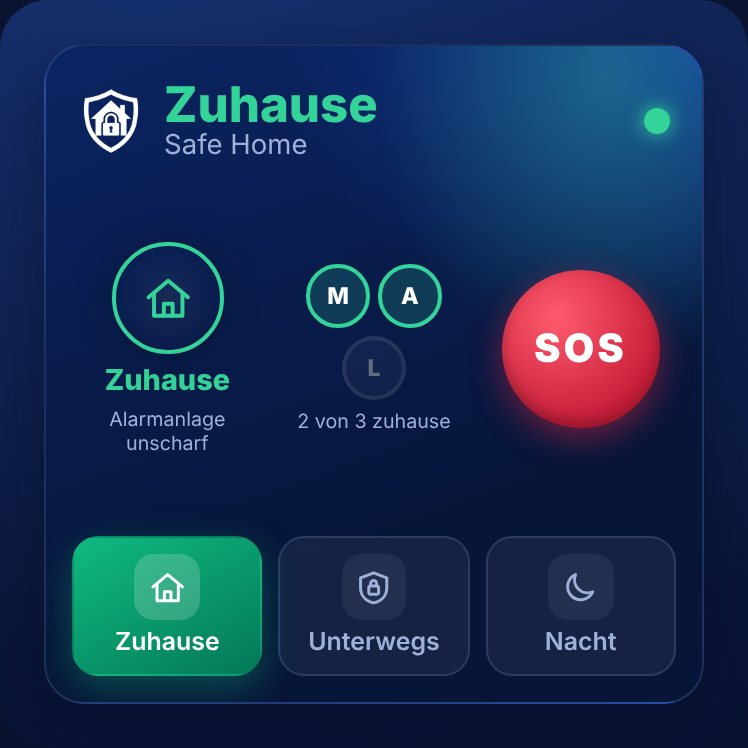 |

| Alarm – the whole card turns red | Tablet |
|---|---|
| 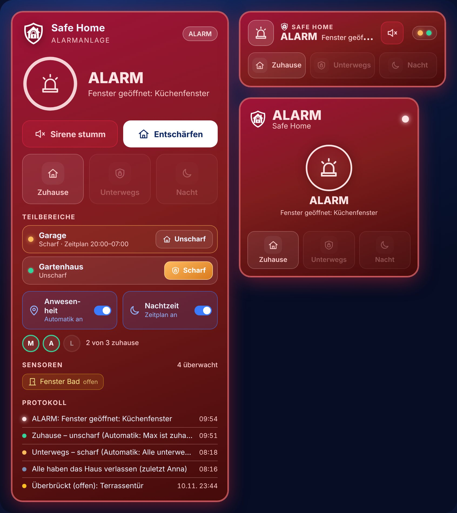 | 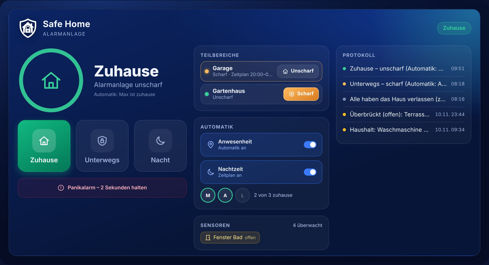 |

| Settings page | Texts & templates | Smartphone |
|---|---|---|
| 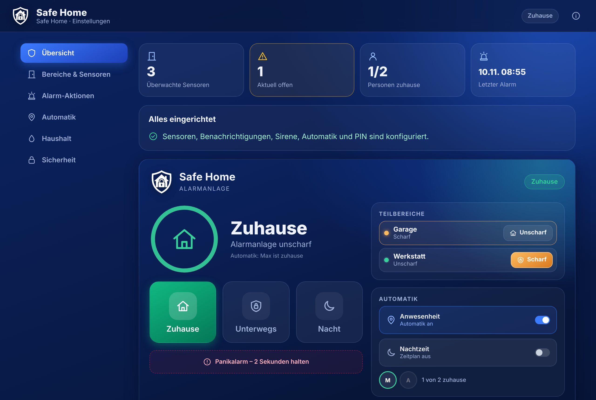 | 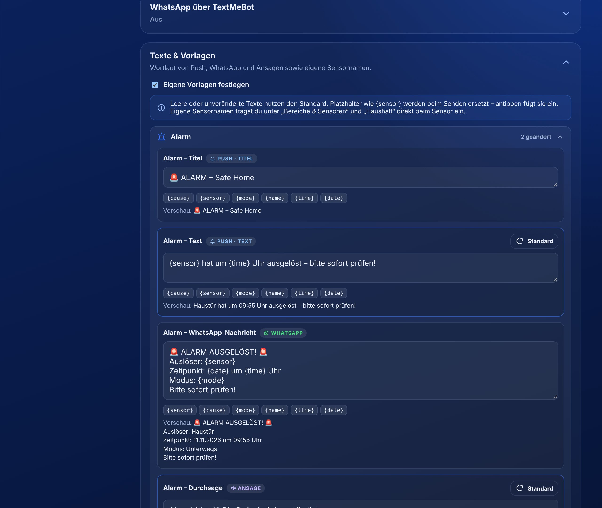 | 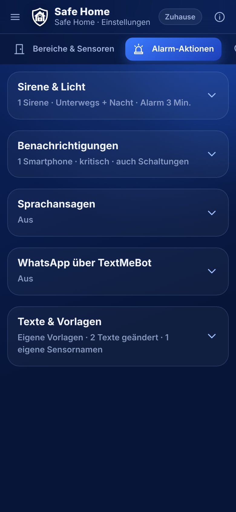 |

## Contents

- [Installation & first steps](#installation--first-steps)
- [The Safe Home page](#the-safe-home-page)
- [Modes & automation](#modes--automation) – [Day and night automation](#day-and-night-automation), [Weekly schedule](#weekly-schedule), [Delays & alarm duration](#delays--alarm-duration)
- [Sensors](#sensors) – [Type & announcements](#sensor-type--announcements), [Partitions](#partitions), [Household](#household-eg-water-sensors), [Batteries](#battery-monitoring)
- [When an alarm goes off](#when-an-alarm-goes-off) – [Siren](#audible-alarm), [Push](#push-notifications), [Announcements & Alexa](#announcements--alexa), [WhatsApp](#whatsapp-textmebot), [Texts & templates](#texts--templates), [Function test](#function-test--triggering-an-alarm-from-a-sensor)
- [PINs & security](#pins--security)
- [Dashboard cards](#dashboard-cards)
- [Designs](#designs)
- [For your own automations](#for-your-own-automations) – entities, services, events
- [Troubleshooting](#troubleshooting)

---

## Installation & first steps

### Via HACS (recommended)
1. HACS → ⋮ → **Custom repositories** → `https://github.com/digital7even/safe_home`, category **Integration**.
2. Install **Safe Home** and restart Home Assistant.
3. **Settings → Devices & services → Add integration → Safe Home**.

### Manual
Copy the folder `custom_components/safe_home` to `config/custom_components/safe_home` and restart Home Assistant.

> The dashboard cards are loaded and registered as a dashboard resource automatically – nothing to add by hand. After an update, clear the browser cache or reload the app if needed.

### Ready in five minutes
The setup wizard asks for the essentials (name & PIN, sensors, delays, actions, automation). Everything else is configured afterwards in the sidebar under **Safe Home**:

1. **Areas & sensors** – *Add suggestions* takes over door, window and motion sensors in one click. Per sensor: *Away*, *Night*, *Delayed*.
2. **Alarm actions** – choose a siren and tick your smartphone (Companion App) for push messages.
3. **Automation** – pick the people for the home zone and set the night-mode times.
4. **Security** – create a PIN for yourself.
5. **Overview → Function test** – trigger a real alarm from a sensor once and check that everything arrives.

**Tip:** front door with *entry delay*, motion sensors **without** – you can disarm when coming home, while a break-in through a window triggers immediately.

---

## The Safe Home page

After installation, **Safe Home** appears in the sidebar (administrators only). This is where you configure everything – in the same design as the cards.

| Tab | Content |
|---|---|
| **Overview** | Key figures, recommendations for gaps in the configuration, control of the system, **Log** (latest 5 events, all 30 on request, filterable) and **Function test** |
| **Areas & sensors** | Name of the system and up to 3 **partitions**, **Monitored sensors** (type, area, modes, custom name), **Delays** as a table with live timeline, **Monitoring** (open/unavailable sensors, batteries) |
| **Alarm actions** | **Siren & lights**, **Notifications**, **Announcements**, **WhatsApp**, **Texts & templates** |
| **Automation** | **Presence detection**, **Weekly schedule**, **Night mode** and – expandable – *How does the automation work?* |
| **Household** | Household sensors, **Notify via** push / WhatsApp / announcement, all clear |
| **Security** | **PIN entry** and **Manage PINs** |
| **Info** (ⓘ top right) | **Display**, Android widget, dashboard resource status, version, links |

**Tidy despite many options:**
- **Summary:** collapsed, each section shows what is set – e.g. *"1 siren · Away + Night · Alarm 3 min"* or *"WhatsApp – Off"*.
- **Advanced:** rarely used settings sit behind the *Advanced* link in their section (e.g. siren time window, camera snapshot, PIN lock).
- **Info → Display** (per browser/device): *Expand settings by default*, *Hide sub-options of disabled features* (default: on – settings of a switched-off feature stay hidden until you switch it on) and *Use Home Assistant theme* (Beta).

Changes only apply after **Save** – the bar appears at the bottom automatically. Safe Home validates everything first and highlights errors. With several instances, pick one at the top right.

### Android widget (Companion App)
Under **Info → Android widget**, Safe Home generates a ready-made **template widget** for the Android home screen in the style of the compact card: coloured state with icon, hint line and the three modes. Optionally with people at home, open sensors and a dark blue background.

1. Tap **Copy template**.
2. Long-press the home screen → Widgets → Home Assistant → drag **Template** onto the home screen.
3. Paste the template and save.

To switch modes, add button widgets with `alarm_control_panel.alarm_arm_away`, `alarm_arm_night` and `alarm_disarm`. Details: [Android widgets of the Companion App](https://companion.home-assistant.io/docs/integrations/android-widgets).

---

## Modes & automation

| Mode | State | Monitors |
|---|---|---|
| 🏠 **Home** | disarmed | nothing |
| 🛡️ **Away** | armed | all selected sensors |
| 🌙 **Night** | partially armed | only the night sensors (e.g. doors and windows, no motion sensors) |

Switch modes on any card, via a service – or let Safe Home do it. The **home-zone automation** ("Presence detection") and **night mode on a schedule** ("Night time") each have a switch on the cards and in the *Automation* tab; it applies immediately, without saving.

### Day and night automation

| Situation | Safe Home |
|---|---|
| Last person leaves the home zone | After the waiting time **Away** – even directly from night mode. |
| First person comes home | **Away off** – also during the entry delay or an alarm. At night, **night mode** returns after the waiting time (default 10 min). |
| **Night starts**, someone is home | **Night mode**. If Away was active automatically, it switches over. |
| **Night starts**, nobody home | **No night mode** – Away stays on or is switched on. |
| Someone comes home **at night** | Briefly disarmed, then night mode again after the waiting time (*Night mode again after coming home at night after … minutes*, 0 = stays disarmed). |
| **Night ends**, someone home | Disarmed ("good morning"). |
| **Night ends**, nobody there | Not disarmed but **Away** – the empty house stays protected. |

- People-related steps only apply with the home-zone automation switched on. Without it, Safe Home only follows the schedule and never disarms an empty house in the morning.
- **Away chosen by hand** is never overridden by the automation.
- On the page, *Automation → How does the automation work?* shows these rules with your current times.

### Weekly schedule
Under **Automation → Weekly schedule** you draw fixed armed times per weekday: drag bars for **Away** (orange) or **Night** (purple); outside the bars the system is **disarmed**. Drag the edges to change the time, drag the bar to move it, *Disarmed* erases. Grid: 15 minutes. *Copy Monday to Tue–Fri* and *Clear all* help with setup.

- Only active while **"Presence detection" is off**.
- At the start of a bar the system arms (with exit delay), at the end it disarms – but only if the schedule armed it. Manual modes and running alarms stay untouched.
- Bars that meet across midnight (e.g. Tue 22–24 and Wed 0–6) count as one period.
- While the schedule is active, the night-mode schedule pauses – they never overlap.

### Delays & alarm duration
- **Exit and entry delay** separately for Away and Night – on the page as a compact table with the live timeline below. The exit delay can be skipped on any card with **"Arm now"**.
- Only sensors marked *Delayed* (e.g. front door) start the countdown. Closing the door doesn't end it – only disarming does. If a sensor **without** delay reports during the countdown (e.g. motion in the living room), the alarm starts **immediately**.

| Setting | Meaning |
|---|---|
| **Alarm duration** | How long the alarm stays active; afterwards armed again (if *re-arm afterwards* is on), otherwise until disarmed. `0` = until disarmed. |
| **Siren duration** | How long the siren sounds; afterwards the alarm continues **silently** – push, WhatsApp and lights keep running. `0` = for the entire alarm duration. |

Example: alarm 10 min, siren 3 min → 3 minutes of siren, 7 minutes of silent alarm, then armed again.

---

## Sensors

### Sensor type & announcements
For each sensor you choose the **type** – **door contact, window contact, motion sensor, presence sensor, water sensor or camera**. Safe Home suggests it from the device class. The type determines the wording of all messages:

| Type | Push / WhatsApp / log | Announcement |
|---|---|---|
| Door contact | Door opened: Front door | Attention, possible break-in! Open door detected: Front door. |
| Window contact | Window opened: Kitchen | Attention, possible break-in! Open window detected: Kitchen. |
| Motion sensor | Motion detected: Hallway | Attention, possible break-in! Motion detected: Hallway. |
| Presence sensor | Presence detected: Living room | Attention, possible break-in! Person detected: Living room. |
| Camera | Camera detected motion: Driveway | Attention, possible break-in! Motion detected on camera: Driveway. |
| Water sensor | Water detected: Basement | Attention, water alarm! Water detected: Basement. |

All of these texts and the sensor names can be changed under [Texts & templates](#texts--templates).

**More protection**
- **Open windows when arming:** bypass and report, or block arming. A bypassed sensor is monitored again as soon as it closes.
- **Tamper/radio loss:** notification when a sensor becomes unavailable while armed.
- **No false alarms after restarts:** only real changes from "closed" to "open" trigger. State and log survive restarts.

### Partitions
Besides the **main area** (Home / Away / Night) you can create up to **3 partitions** under *Areas & sensors*, e.g. *Garage*, *Garden shed* or *Workshop*. A partition only knows **Armed** and **Disarmed** and gets its own entity `alarm_control_panel.<name>`.

| Setting | Description |
|---|---|
| **Name** | Shown on the cards and in every message (push, WhatsApp, announcement, log) |
| **Sensors** | Choose the **area** per sensor in the sensor table – each sensor belongs to exactly one area |
| **Siren** | *Like main area*, *Own sirens* (e.g. only the outdoor siren) or *No siren* |
| **Delays** | Own exit/entry delay, *Delayed* per sensor |
| **Core times** | Armed at the start time on selected weekdays, disarmed at the end time (e.g. 18:30–06:00, Mon–Fri) |
| **Own presence** | Armed when all selected people are away; disarmed as soon as one returns |

Alarms use the same outputs as the main area – always naming the area, e.g. *"🚨 ALARM – Garage"*. On the cards, partitions appear as a list or dots; an alarm in a partition turns the whole card red and shows a banner with a disarm button.

### Household (e.g. water sensors)
In the **Household** tab you add sensors that are monitored **independently of the alarm system** – also in Home mode. They never trigger a siren but report via **push**, **WhatsApp** and/or **announcement**.

- Per sensor you choose **"Report when"** – e.g. *Wet* for a water sensor. Other entities work too (e.g. `sensor.dryer_status` = `done`).
- **Suggestions:** all water sensors in one click. **All clear** ("Washing machine is dry again") optional.
- Reporting sensors appear on the cards (💧) and in the log; automations can use the attribute `household_alerts`.

### Battery monitoring
Safe Home checks the batteries of all monitored sensors (battery entity of the same device or the `battery_level` attribute). Below the threshold (default **20 %**, 5–90 %) a yellow chip appears on the cards, a log entry is written and – if enabled – a push is sent. Each battery is reported only once until it has been replaced (5 % above the threshold).

---

## When an alarm goes off

| Channel | What happens |
|---|---|
| 🔊 **Siren** | `siren`, `switch`, `input_boolean` or `script` – fine-tuned by mode, time window and sensor |
| 💡 **Alarm lights** | Selected lights turn red and are restored when disarming |
| 📱 **Push** | Companion App, optionally **critical** (bypasses silent mode), with **camera snapshot** and *Silence siren* / *Disarm* buttons |
| 🗣️ **Announcement** | Via speakers (TTS) and/or Alexa – matching the sensor type |
| 💬 **WhatsApp** | Via TextMeBot, with escalation to further recipients and all clear |
| 🖥️ **Cards** | The whole card turns red and pulses – everything returns to normal when disarmed |
| ⚙️ **Automations** | Event `safe_home_triggered`, persistent notification in Home Assistant |

### Audible alarm
Under **Alarm actions → Siren & lights** you decide when the siren sounds. One line summarises the setting, e.g. *"Siren sounds: Away + Night · from 22:00 to 06:00 – 4 of 5 sensors trigger the siren"*.

| Setting | Meaning |
|---|---|
| **Siren in mode** | *Away* and/or *Night* (default: both) |
| **Time window** (*Advanced*) | From–to, also across midnight. Default: around the clock |
| **Siren per sensor** (*Advanced*) | *Siren* or *Silent* per sensor, plus *All on* / *All silent* |

If a rule applies, the alarm is **silent**: push, WhatsApp, lights (and by default the announcement) run, only the siren stays off; the log names the reason. If a sensor that may trigger the siren reports meanwhile, the siren starts afterwards. **Panic alarm** and manual triggering always sound.

### Push notifications
Under **Alarm actions → Notifications** you pick the smartphones with the Companion App. Options: *Critical – rings even when silent*, *also when arming and disarming*, and under *Advanced* the *Disarm* button (with device unlock) and the camera snapshot.

### Announcements & Alexa
Under **Alarm actions → Announcements** you choose the TTS service and speakers. Plus:
- **Announcement during the entry delay** – *"Please disarm the alarm system within 30 seconds."*, repeated with the remaining time (default every 10 s, 0 = once).
- **Announcement for household alarms** and **announcement during a silent alarm**.
- **Alexa devices** ([Alexa Media Player](https://github.com/alandtse/alexa_media_player)): selectable after ticking *Use Alexa devices*; they speak with the normal Alexa voice, no TTS service needed.

### WhatsApp (TextMeBot)
Safe Home sends alarms straight to WhatsApp – no automation needed. Configure under **Alarm actions → WhatsApp via TextMeBot**.

> **Important:** [TextMeBot](https://textmebot.com) is a **paid third-party service** (not by Safe Home, Home Assistant or WhatsApp). There is no delivery guarantee – use WhatsApp only in addition to push and siren. Phone numbers and texts are sent to TextMeBot.

| Setting | Meaning |
|---|---|
| **Recipients** | Name, WhatsApp number (international, e.g. `+491701234567`, or group ID) and TextMeBot API key. Up to 10, each with an **Active** tick |
| **Send: immediately / after X min** | With a delay = **escalation**: only if the alarm hasn't been switched off by then |
| **All clear** | Everyone who received an alarm message gets "✅ All clear …" when it is switched off |
| **Other messages** | Optionally also mode changes, tamper and wrong PIN (to recipients set to "immediately") |

You set the wording of the messages under [Texts & templates](#texts--templates). The pre-filled example data is never sent to. Prefer an automation? See [`docs/automation-whatsapp.yaml`](docs/automation-whatsapp.yaml) – please use only one of the two variants.

### Texts & templates
Under **Alarm actions → Texts & templates** you set the wording yourself. Tick **Use custom templates** – without it, the built-in texts and the names from Home Assistant apply.

<p align="center"></p>

- **47 templates in six groups:** *Alarm*, *Entry delay*, *Armed & disarmed*, *Notices*, *Household* and *Texts per sensor type*. Each is labelled **Push · title**, **Push · text**, **WhatsApp**, **Announcement** or **Cause**.
- **Pre-filled with the default:** every field shows the current text. Empty or unchanged texts keep using the default; **Default** resets one field, *Reset all texts to default* resets everything.
- **Placeholders** such as `{sensor}`, `{cause}`, `{mode}`, `{zone}`, `{time}`, `{date}` or `{name}` – tap to insert, a tooltip explains each. Unknown placeholders simply stay as they are.
- **Live preview** below each field with sample values.
- **Custom sensor names:** with templates switched on, every sensor under *Areas & sensors* and *Household* gets a *Custom name* field. It is used in push, WhatsApp, announcements, the log and on all dashboard cards – if none is set, the name from Home Assistant.

Example: *Alarm – text* = `{sensor} triggered at {time} – please check now!` → *"Front entrance triggered at 21:47 – please check now!"*

### Function test & triggering an alarm from a sensor
Under **Overview → Function test** you check single outputs (notification, siren 3 s, alarm light 5 s, announcement, WhatsApp) – or trigger a **real alarm from a sensor**:

1. Choose **Alarm system** (main area and partitions) or **Household**, then a sensor.
2. **Trigger alarm** – confirm with a second click.
3. Sirens, lights, announcement, push and WhatsApp run **exactly as in an emergency**, with the real wording – the word "test" appears nowhere.
4. **Reset** ends everything and restores the previous state.

Let your housemates and WhatsApp recipients know beforehand.

---

## PINs & security

Under **Security** every Home Assistant user gets their **own PIN**; plus **guest PINs**, e.g. for tradespeople or holiday guests.

| | |
|---|---|
| **User PINs** | One PIN per user. 🎲 creates a random 6-digit PIN, 👁 shows it. |
| **Guest PINs** | Name, PIN, **valid from** / **valid until** (optional), can be disabled. Status: *Active*, *Scheduled*, *Expired*, *Disabled*, *Unlimited*. |

- **PIN function on/off** – master switch under *PIN entry*.
- **Per area:** *Require PIN for* the main area and each partition separately. An area without a tick or without an assigned PIN can be operated without a PIN.
- **Per PIN:** *May switch* – e.g. the tradesperson only *Garage*.
- **Silencing the siren** also requires the PIN (can be turned off) – a burglar at the wall tablet can't silence it. Automations using `safe_home.silence` need no PIN.
- **Lock after wrong PINs:** after 5 wrong attempts (adjustable) locked for 5 minutes, with a critical push. Survives restarts.
- Log and messages name whose PIN was used. PINs are at least 4 characters long and unique.
- **Panic alarm:** hold the button on the card for 2 seconds or call `safe_home.panic`.

---

## Dashboard cards

Six variants, all available under **Add card**. During an alarm – in the main area or a partition – **the whole background of every card turns red**; when disarmed, everything returns to normal.

| Card | Type | For |
|---|---|---|
| **Standard** | `custom:safe-home-card` | All information stacked |
| **Compact** | `custom:safe-home-compact-card` | Only the state (with countdown) and the three modes |
| **Tablet** | `custom:safe-home-tablet-card` | All information, one to three columns by width, large buttons |
| **Square** | `custom:safe-home-square-card` | 1:1 for small wall displays: state, modes, round SOS button |
| **Badge** | `custom:safe-home-badge-card` / `custom:safe-home-badge` | Logo and state, transparent – also as a real dashboard badge |
| **Custom** | `custom:safe-home-custom-card` | Full screen for smartphone & tablet with many modules |

```yaml
type: custom:safe-home-card
entity: alarm_control_panel.safe_home
```

### Options (all variants)
```yaml
title: My home          # optional
layout: standard        # standard | compact | tablet | custom
show_automation: true   # home-zone & night automation, people
show_sensors: true      # open / bypassed sensors
show_events: true       # log
events_count: 5         # tablet: default 8
show_panic: true        # panic button (hold 2 s)
zones_display: inline   # tablet & custom: inline | dots | hidden
background_color: [20, 110, 70]   # custom background colour (red, green, blue)
```
If a PIN is required, a keypad opens. Set the **background colour** in the card editor with three sliders – surfaces, text and accent are derived to match.

### Square
```yaml
type: custom:safe-home-square-card
entity: alarm_control_panel.safe_home
show_panic: true        # round SOS button (hold 2 s)
square_status: false    # current mode, large
square_persons: false   # people home / away
square_view: all        # all = one view, swipe = swipe pages
```

### Badge
```yaml
type: custom:safe-home-badge-card
entity: alarm_control_panel.safe_home
show_zones: true      # partitions as dots
zone_names: false     # names next to the dots
show_name: false      # system name below the state
red_logo: false       # red instead of white logo (for light backgrounds)
```

### Custom – full screen for smartphone & tablet
Everything from the standard layout plus modules that can each be switched on and off in the editor, arranged by drag & drop and scaled in four sizes.

| Smartphone | Tablet |
|---|---|
| 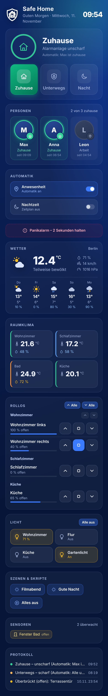 |  |

| Module | Shows |
|---|---|
| **Clock & greeting** | Large time, "Good morning/afternoon/evening" and date |
| **People** | Profile pictures with *Home*, *Away* or zone name and since when |
| **Weather** | Temperature, condition, humidity, wind, pressure, forecast (2–8 entries) |
| **Room climate** | Thermometers and humidity per room, coloured by temperature |
| **Covers** | Up / stop / down, grouped by room – classic or as an animated cover |
| **Lights** | Lights and switches as tiles, with brightness and "All off" |
| **Scenes & scripts** | One tap starts them |
| **Cameras** | Live snapshots, refreshed automatically |
| **Fuel prices** | Up to 4 petrol stations (e.g. Tankerkönig), cheapest open one highlighted green |
| **Custom widgets 1–4** | Any dashboard cards as YAML – including HACS cards |
| **Alarm system** | Automation switches, open sensors, log, panic button |

<details>
<summary><b>All options of the custom card</b></summary>

```yaml
type: custom:safe-home-custom-card
entity: alarm_control_panel.safe_home
device: auto            # auto | phone | tablet
fullscreen: true        # fills the screen – best in a panel view
accent: auto            # auto | blue | indigo | cyan | emerald | amber | red
show_clock: true
show_people: true
people: []              # empty = people of the alarm system
show_weather: true
weather_entity: weather.forecast_home
show_forecast: true
forecast_days: 5
show_climate: true
climate_entities: [sensor.living_room_temperature, sensor.living_room_humidity]
show_covers: true
cover_entities: [cover.living_room, cover.bedroom]
covers_group_by_area: true
covers_design: animated # classic | animated
show_lights: true
light_entities: [light.living_room]
show_scenes: true
scene_entities: [scene.movie_night]
show_cameras: true
camera_entities: [camera.driveway]
camera_refresh: 10      # seconds
show_fuel: true
fuel_entities: [sensor.aral_main_street_super_e10]
fuel_sort: false        # true = cheapest first
show_custom_1: true     # custom widgets 1–4
custom_1_title: Energy
custom_1_card:
  type: entities
  entities: [sensor.power_consumption]
widget_sizes:           # xs | s | m | l – via − / + in the editor
  cameras: s
layout_order:           # set by drag & drop
  a: [alarm, people, automation, panic]
  b: [weather, climate, fuel, cameras, custom1]
  c: [covers, lights, scenes, sensors, events]
```
</details>

**Arranging:** in the card editor under *Layout* by drag & drop, or directly on the dashboard (edit mode) via each widget's handle. On smartphones the columns are stacked.

---

## Designs

### Home Assistant theme (Beta)
Under **Info → Display → Use Home Assistant theme** <sup>(Beta)</sup> the Safe Home page **and all cards** use the colours of your active HA theme (light or dark) – helpful with display problems caused by custom themes. The state colours stay, on light backgrounds the red logo is used. Applies on all devices after saving.

### "Safe Home" theme for all of Home Assistant
Safe Home ships its own HA theme with a light and a dark mode – it is added automatically at startup. Select it under **Profile → Theme → Safe Home**, also for individual dashboards. It remains available after *Reload themes*.

---

## For your own automations

### Entities
| Entity | Description |
|---|---|
| `alarm_control_panel.safe_home` | The alarm system (Home / Away / Night) |
| `alarm_control_panel.<partition>` | One per partition (armed / disarmed) |
| `switch.safe_home_presence_automation` | Home-zone automation on/off |
| `switch.safe_home_night_automation` | Night-mode schedule on/off |
| `binary_sensor.safe_home_open_sensors` | On when a monitored sensor is open |
| `binary_sensor.safe_home_siren_active` | On while the siren is sounding |
| `sensor.safe_home_last_event` | Last log entry |
| `sensor.safe_home_last_alarm` | Time of the last alarm |
| `sensor.safe_home_people_home` | Number of people at home |

*(Exact IDs depend on name and language.)* Useful attributes of the alarm system: `triggered_sensors`, `silent_alarm`, `silent_reason`, `household_alerts`, `zones`, `sensor_names`.

### Services
| Service | Description |
|---|---|
| `alarm_control_panel.alarm_disarm / alarm_arm_away / alarm_arm_night` | Standard Home Assistant services |
| `safe_home.panic` | Immediate alarm |
| `safe_home.silence` | Sirens off, alarm continues (optional `code`) |
| `safe_home.skip_exit_delay` | Skip a running exit delay (partitions too) |
| `safe_home.set_auto_mode` | Switch the automations (`enabled`, optional `night`) |

### Events
- `safe_home_triggered` – `cause`, `mode`, `name` (partitions: `mode: zone`, plus `zone` and `zone_id`)
- `safe_home_state_changed` – `state`, `mode`, `changed_by`

```yaml
# Example: open all covers on alarm
trigger:
  - platform: event
    event_type: safe_home_triggered
action:
  - service: cover.open_cover
    target:
      area_id: ground_floor
```

---

## Troubleshooting

**"Configuration error" after starting the app / cards missing:** Safe Home delivers the cards like a HACS card – the file lives in `config/www/safe_home/` and is registered as a **dashboard resource** (`/local/safe_home/safe-home-card.js`). If the `www` folder didn't exist before, **restart Home Assistant once more**. **Info** (ⓘ) shows the status; if there is a problem, *Register now* appears there.

**Dashboards/resources in YAML mode:** please add the resource yourself:
```yaml
lovelace:
  resources:
    - url: /local/safe_home/safe-home-card.js
      type: module
```

**"Custom element doesn't exist: safe-home-…":** Safe Home registers its cards correctly even when other cards replace the element registry. If the message still appears, please post the build ID from the card editor and a screenshot of the browser console (F12) in an [issue](https://github.com/digital7even/safe_home/issues).

**Device keeps jumping to the login page** (e.g. Fully Kiosk): set the start URL to the dashboard, allow web storage and turn off clearing cache/cookies on reload.

**Custom texts don't appear:** check that *Use custom templates* is ticked and saved. A text that equals the default exactly is not stored.

---

## Note

Safe Home is a software alarm system based on Home Assistant. It does not replace a certified intrusion alarm system with backup power and connection to a monitoring service. For maximum reliability, use a UPS for the Home Assistant server and the radio gateway.

---

<p align="center">
  Made with ❤️ in Germany.<br>
  Thank you for using <b>Safe Home</b>!<br><br>
  <a href="https://github.com/digital7even"><b>Digital7even</b></a>
</p>
