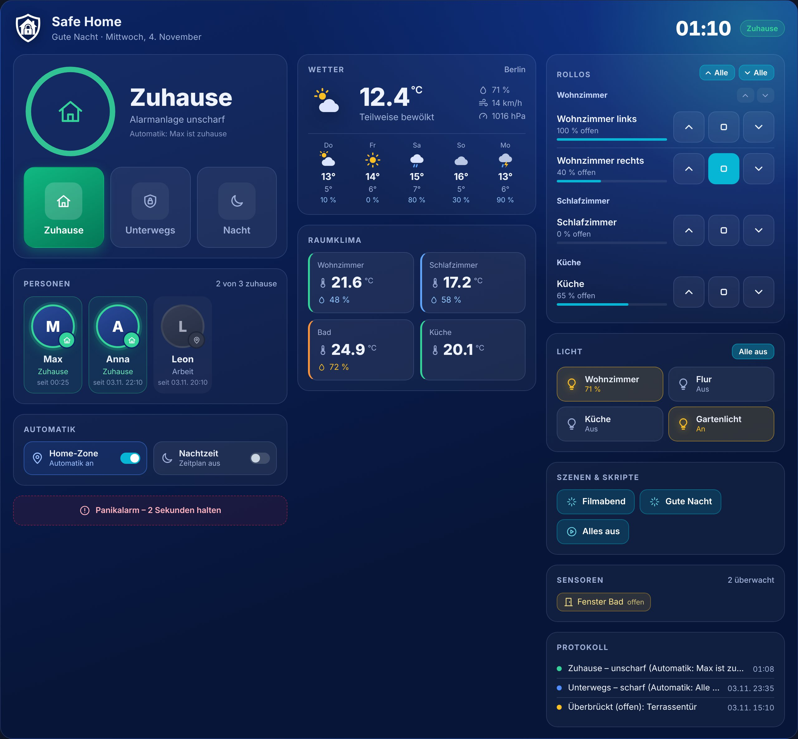
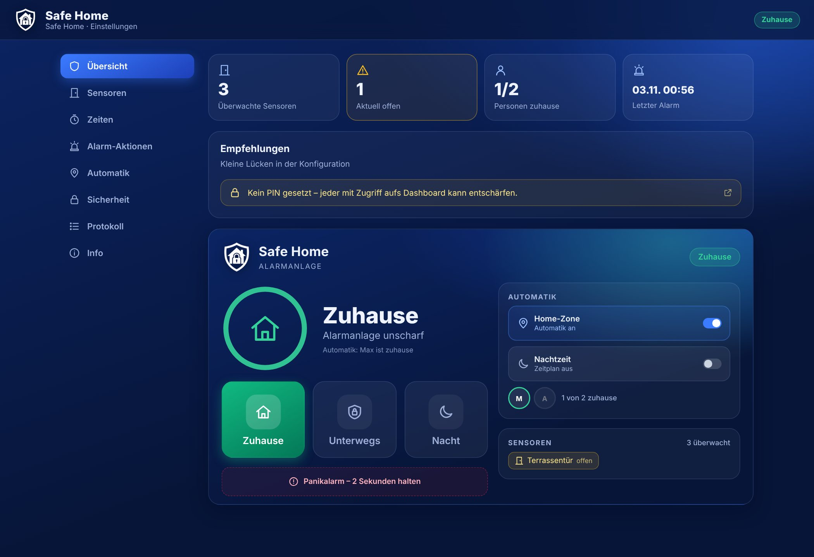
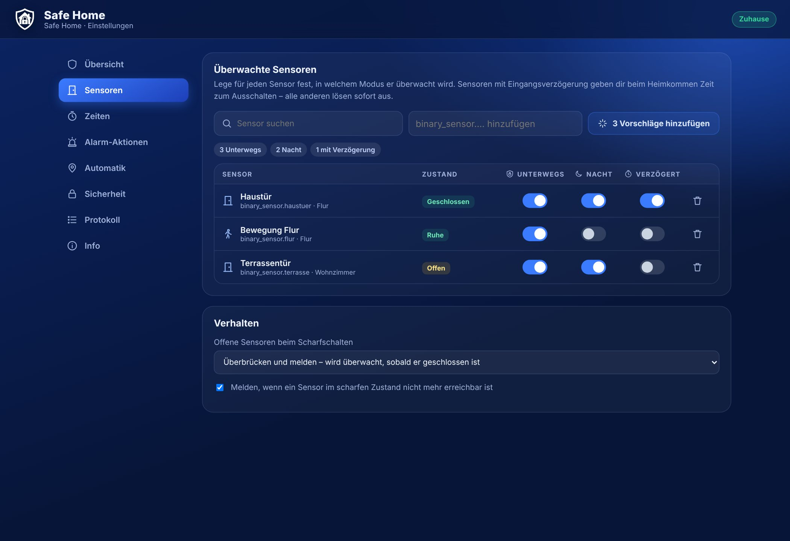
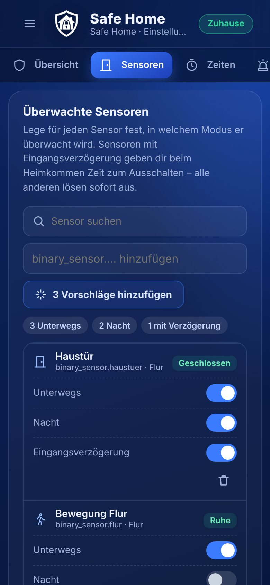
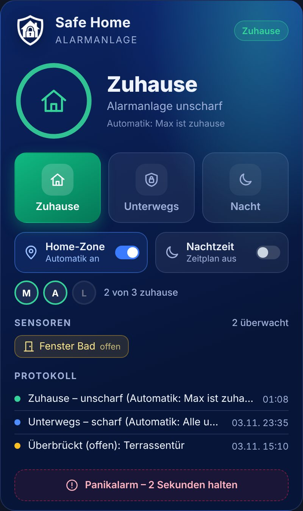
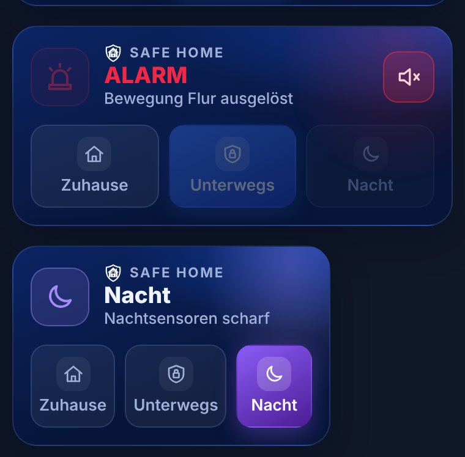
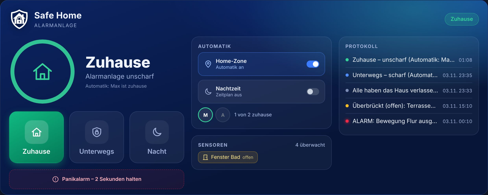
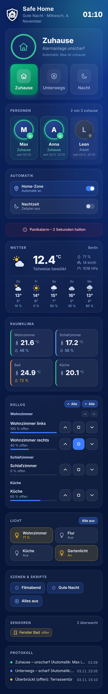

<p align="center">
  
</p>

<h1 align="center">Safe Home</h1>
<p align="center"><b>Die Alarmanlage für Home Assistant – weitestgehend automatisch.</b></p>

<p align="center">
  
  
  
</p>

<p align="center"></p>

---

## Funktionen

**Drei Modi**
| Modus | Zustand | Überwacht |
|---|---|---|
| 🏠 **Zuhause** | Ausgeschaltet (unscharf) | nichts |
| 🛡️ **Unterwegs** | Scharfgeschaltet | alle ausgewählten Sensoren |
| 🌙 **Nacht** | Teilweise scharf | nur die für die Nacht gewählten Sensoren |

**Automatik**
- **Automatisch scharf**, sobald alle ausgewählten Personen die Home-Zone verlassen haben (mit einstellbarer Wartezeit).
- **Automatisch unscharf**, sobald die erste Person nach Hause kommt – auch während der Eingangsverzögerung oder eines laufenden Alarms.
- **Nachtmodus nach Zeitplan** (z. B. 23:00–06:30), optional nur wenn jemand zuhause ist.
- Beide Automatiken lassen sich jederzeit über Schalter im Dashboard ein- und ausschalten.

**Bei einem Alarm**
- Sirenen / akustische Signalgeber einschalten (`siren`, `switch`, `input_boolean`, `script`)
- Alarmbeleuchtung rot einschalten (wird beim Unscharfschalten wieder ausgeschaltet)
- Push-Benachrichtigung an die Companion App – auf Wunsch als **kritische Benachrichtigung** (umgeht Lautlos/Fokus), mit **Kamera-Schnappschuss** und Tasten **„Sirene stumm“** und optional **„Entschärfen“** (mit Geräte-Entsperrung)
- **Sprachausgabe** über Lautsprecher (TTS) – Warnung während der Eingangsverzögerung und Alarmansage
- Persistente Benachrichtigung in Home Assistant
- Ereignis `safe_home_triggered` für eigene Automationen

**Sicherheit & Komfort**
- **Ausgangsverzögerung** und **Eingangsverzögerung** getrennt für Unterwegs und Nacht
- Nur ausgewählte Sensoren (z. B. Haustür) mit Eingangsverzögerung – alle anderen lösen sofort aus
- **Offene Fenster beim Scharfschalten**: überbrücken und melden oder Scharfschalten verhindern. Ein überbrückter Sensor wird automatisch wieder überwacht, sobald er geschlossen wurde.
- **Sabotage-/Funkverlust-Erkennung**: Meldung, wenn ein Sensor im scharfen Zustand nicht mehr erreichbar ist
- Optionaler **PIN-Code** (Ziffern oder Text), Meldung bei falscher PIN-Eingabe
- **Panikalarm** (Taste in der Karte 2 Sekunden halten oder Dienst `safe_home.panic`)
- Schutz vor Fehlalarmen nach Neustarts: nur echte Wechsel von „geschlossen“ auf „offen“ lösen aus
- Zustand und Protokoll bleiben über Neustarts erhalten
- Ereignisprotokoll (letzte 30 Einträge)

---

## Installation

### Über HACS (empfohlen)
1. HACS → ⋮ → **Benutzerdefinierte Repositories** → `https://github.com/digital7even/safe_home`, Kategorie **Integration**.
2. **Safe Home** installieren und Home Assistant neu starten.
3. **Einstellungen → Geräte & Dienste → Integration hinzufügen → Safe Home**.

### Manuell
Den Ordner `custom_components/safe_home` nach `config/custom_components/safe_home` kopieren und Home Assistant neu starten.

> Die Dashboard-Karte wird von der Integration automatisch geladen – eine Ressource muss **nicht** manuell angelegt werden. Nach einem Update ggf. den Browser-Cache leeren bzw. die App neu laden.

---

## Safe-Home-Seite in der Seitenleiste

Nach der Installation erscheint **Safe Home** in der Seitenleiste (nur für Administratoren). Dort lässt sich alles übersichtlicher einstellen als im Einrichtungsdialog – im gleichen Design wie die Karten.

| Übersicht | Sensoren | Smartphone |
|---|---|---|
|  |  |  |

| Bereich | Inhalt |
|---|---|
| **Übersicht** | Kennzahlen (überwachte/offene Sensoren, Personen zuhause, letzter Alarm), Empfehlungen zu Lücken in der Konfiguration und die Steuerung der Alarmanlage |
| **Sensoren** | Alle Sensoren in einer Tabelle mit Live-Zustand und Raum. Pro Sensor per Schalter festlegen: *Unterwegs*, *Nacht*, *Eingangsverzögerung*. Suche, Sensor hinzufügen und **Vorschläge** (alle Tür-, Fenster- und Bewegungssensoren auf einen Klick) |
| **Zeiten** | Grafischer Ablauf (Ausgangsverzögerung → scharf → Eingangsverzögerung → Alarm), der sich beim Eintippen sofort anpasst |
| **Alarm-Aktionen** | Sirenen, Alarmlicht, Benachrichtigungen, Kameras, Sprachausgabe – mit **Test-Tasten** für Benachrichtigung, Sirene (3 s), Alarmlicht (5 s) und Ansage |
| **Automatik** | Home-Zone-Personen mit aktuellem Status, Auto-Scharf/-Unscharf, Nachtmodus-Zeitplan |
| **Sicherheit** | Name der Instanz, PIN-Code |
| **Protokoll** | Die letzten 30 Ereignisse, filterbar nach Alarmen, Schaltungen und Warnungen |
| **Info** | Version, Links, Dankeschön |

Änderungen werden erst mit **Speichern** übernommen (die Leiste unten erscheint automatisch). Vor dem Speichern prüft Safe Home alle Angaben und markiert Fehler. Bei mehreren Instanzen wählst du oben rechts die gewünschte aus.

## Einrichtung

Der Einrichtungsassistent führt durch fünf Schritte. Alles kann später auf der **Safe-Home-Seite in der Seitenleiste** oder unter **Safe Home → Konfigurieren** geändert werden.

1. **Name & PIN** – optionaler PIN-Code, wahlweise auch fürs Scharfschalten.
2. **Sensoren** – Sensoren für *Unterwegs*, für *Nacht* und welche davon eine *Eingangsverzögerung* haben.
3. **Verzögerungen** – Ausgangs-/Eingangsverzögerung, Alarmdauer, erneutes Scharfschalten nach dem Alarm.
4. **Aktionen** – Sirenen, Alarmlicht, Benachrichtigungsdienste (z. B. `mobile_app_mein_handy`), Kameras, Sprachausgabe.
5. **Automatik** – Personen für die Home-Zone, Auto-Scharf/-Unscharf, Nachtmodus-Zeitplan.

**Empfehlung:** Haustür in *Eingangsverzögerung*, Bewegungsmelder **nicht** – so kannst du beim Heimkommen entschärfen, Einbrecher über Fenster lösen sofort aus.

---

## Dashboard-Karten

Es gibt vier Varianten. Alle erscheinen im Dashboard unter **Karte hinzufügen** und werden automatisch geladen.

| Standard | Kompakt | Tablet |
|---|---|---|
|  |  |  |
| Alle Infos untereinander | Nur Status und die Modi | Alle Infos, breit und responsiv |

### Standard
```yaml
type: custom:safe-home-card
entity: alarm_control_panel.safe_home
```

### Kompakt – für kleine Dashboards
Zeigt nur den aktuellen Status (mit Countdown-Balken während der Verzögerungen) und die Tasten Zuhause, Unterwegs und Nacht. Bei einem Alarm erscheint zusätzlich eine Taste zum Stummschalten der Sirene.
```yaml
type: custom:safe-home-compact-card
entity: alarm_control_panel.safe_home
```

### Tablet – für Wand-Tablets
Enthält alle Infos des Standard-Layouts und ordnet sie nach verfügbarer Breite an:
- schmal: eine Spalte
- ab ca. 680 px: Status & Modi links, Automatik & Sensoren rechts, Protokoll darunter
- ab ca. 1060 px: drei Spalten nebeneinander

Große Tasten und ein großer Ziffernblock machen die Bedienung per Finger leicht.
```yaml
type: custom:safe-home-tablet-card
entity: alarm_control_panel.safe_home
```
Tipp: In einer Ansicht vom Typ **Panel** oder **Abschnitte** mit voller Breite nutzt die Karte den Platz am besten.

### Custom – Vollbild für Smartphone & Tablet
Die umfangreichste Karte: alles aus dem Standard-Layout plus zusätzliche Module. Jedes Modul lässt sich im Bearbeitungsmenü ein- und ausschalten und hat einen eigenen aufklappbaren Bereich.

| Smartphone | Tablet |
|---|---|
|  |  |

| Modul | Was es zeigt |
|---|---|
| **Uhr & Begrüßung** | Große Uhrzeit, „Guten Morgen/Tag/Abend“ und Datum im Kopfbereich |
| **Personen** | Große Profilbilder mit Status *Zuhause*, *Unterwegs* oder Zonenname (z. B. *Arbeit*) und seit wann |
| **Wetter** | Deine `weather.*`-Entität mit Temperatur, Zustand, Luftfeuchte, Wind, Luftdruck und Vorhersage (2–8 Einträge) |
| **Raumklima** | Gewählte Thermometer und Luftfeuchte-Sensoren. Werte desselben Geräts werden zu einer Kachel zusammengefasst und nach dem Raum benannt. Farbiger Rand: kalt (< 18 °C), angenehm, warm (> 24 °C); Luftfeuchte unter 35 % oder über 65 % wird markiert |
| **Rollos** | Hoch / Stopp / Runter je Rollo, Position als Balken, nach Räumen gruppiert, je Raum und für alle gemeinsam steuerbar |
| **Licht** | Lampen und Schalter als Kacheln zum Antippen, mit Helligkeit und „Alle aus“ |
| **Szenen & Skripte** | Ein Tipp startet die Szene bzw. das Skript |
| **Kameras** | Live-Standbilder, automatisch aktualisiert (Intervall einstellbar) |
| **Kraftstoffpreise** | Bis zu 4 Tankstellen-Preissensoren (z. B. aus Tankerkönig) mit Name, Adresse, Sorte (Super / Super E10 / Diesel) und Preis mit hochgestellter letzter Ziffer. Die günstigste geöffnete Tankstelle je Sorte wird grün markiert, geschlossene erscheinen ausgegraut; optional nach Preis sortiert |
| **Eigene Widgets 1–4** | Bis zu vier beliebige Dashboard-Karten als YAML-Code – auch Karten aus HACS (`custom:…`). Mit Überschrift erscheinen sie im Safe-Home-Rahmen, ohne Überschrift mit ihrem eigenen Kartenrahmen |
| **Alarmanlage** | Automatik-Schalter, offene Sensoren, Protokoll, Panik-Taste |

Ein Tipp auf Personen, Wetter, Thermometer, Rollo-Namen, Tankstellen oder Kameras öffnet die Detailansicht von Home Assistant.

**Eigene Widgets:** Im Editor unter *Eigenes Widget 1–4* den Schalter aktivieren und den Code der gewünschten Karte in das Feld *Karten-Code (YAML)* einfügen. Den Code einer vorhandenen Karte bekommst du im Karteneditor über ⋮ → *Code-Editor anzeigen*. Beispiel:

```yaml
type: entities
entities:
  - sensor.stromverbrauch
  - sensor.pv_leistung
```

Die Karten werden mit dem Kartenmechanismus von Home Assistant erzeugt und farblich an Safe Home angepasst. Lädt eine HACS-Karte erst später, erscheint sie automatisch, sobald sie bereit ist. Fehlt `type:`, zeigt das Widget einen Hinweis.

**Kraftstoffpreise:** Die Tankerkönig-Integration (in Home Assistant enthalten) legt pro Tankstelle und Sorte einen Sensor an, z. B. `sensor.aral_hauptstrasse_super_e10`. Name, Adresse und Sorte liest Safe Home aus dessen Attributen, den Status *geöffnet/geschlossen* aus dem Status-Sensor derselben Tankstelle. Andere Preis-Sensoren funktionieren ebenfalls; die Sorte wird dann aus dem Namen erkannt.

**Widgets anordnen:**
- **Im Karten-Editor** gibt es den Bereich **Anordnung**: Die drei Spalten stehen nebeneinander, die Widgets lassen sich per Drag & Drop zwischen die Spalten ziehen oder mit den Pfeiltasten verschieben. Ausgeblendete Widgets sind gekennzeichnet und behalten ihren Platz. *Standard-Anordnung* setzt zurück. Wie gewohnt mit *Speichern* übernehmen.
- **Direkt im Dashboard** (Dashboard bearbeiten): Jedes Widget bekommt eine Griffleiste; die neue Anordnung wird sofort in der Dashboard-Konfiguration gespeichert – auch wenn die Karte in einem Stapel oder Abschnitt steckt. Bei Dashboards im YAML-Modus bitte den Karten-Editor verwenden.
- Auf dem Smartphone werden die Spalten untereinander angezeigt: erst Spalte 1, dann 2, dann 3.

**Widget-Größe:** Jedes Widget hat vier Größen – *Sehr klein* (72 %), *Klein* (86 %), *Normal* und *Groß* (115 %). Der gesamte Inhalt wird proportional skaliert; Kacheln, Kamerabilder und Listen ordnen sich dabei automatisch neu an (z. B. mehr Kacheln pro Zeile, wenn das Widget kleiner ist), sodass alles responsiv bleibt.
- **Im Karten-Editor:** im Bereich *Anordnung* mit − und + an jedem Widget.
- **Direkt im Dashboard** (Dashboard bearbeiten): − und + neben der Griffleiste jedes Widgets; die Größe wird automatisch gespeichert.

**Gerät:** *Automatisch* richtet sich nach der Breite (eine, zwei oder drei Spalten). *Smartphone* erzwingt eine Spalte, *Tablet* nutzt größere Tasten und bis zu drei Spalten.
**Vollbild:** füllt den gesamten Bildschirm inkl. Abstand für Notch/Home-Balken – am besten in einer Ansicht vom Typ **Panel**.

```yaml
type: custom:safe-home-custom-card
entity: alarm_control_panel.safe_home
device: auto            # auto | phone | tablet
fullscreen: true
accent: auto            # auto | blue | indigo | cyan | emerald | amber | red
show_clock: true
show_people: true
people: []              # leer = Personen aus der Alarmanlage
show_weather: true
weather_entity: weather.forecast_home
weather_name: Berlin    # optional
show_forecast: true
forecast_days: 5
show_climate: true
climate_entities:
  - sensor.wohnzimmer_temperatur
  - sensor.wohnzimmer_luftfeuchtigkeit
show_covers: true
cover_entities:
  - cover.wohnzimmer
  - cover.schlafzimmer
covers_group_by_area: true
show_cover_all: true
show_lights: true
light_entities:
  - light.wohnzimmer
show_scenes: true
scene_entities:
  - scene.filmabend
show_cameras: true
camera_entities:
  - camera.einfahrt
camera_refresh: 10      # Sekunden
show_fuel: true
fuel_title: Tanken      # optional, Standard „Kraftstoffpreise“
fuel_entities:          # höchstens 4
  - sensor.aral_hauptstrasse_super_e10
  - sensor.shell_gartenweg_super
fuel_sort: false        # true = günstigste zuerst
show_custom_1: true     # eigene Widgets 1–4 (show_custom_N, custom_N_title, custom_N_card)
custom_1_title: Energie # optional
custom_1_card:
  type: entities
  entities:
    - sensor.stromverbrauch
widget_sizes:           # xs | s | m (Standard) | l – wird über − / + gesetzt
  cameras: s
  covers: xs
layout_order:           # wird per Drag & Drop automatisch gesetzt
  a: [alarm, people, automation, panic]
  b: [weather, climate, fuel, cameras, custom1, custom3]
  c: [covers, lights, scenes, sensors, events, custom2, custom4]
```

### Eigene Hintergrundfarbe (alle Varianten)
Im Karten-Editor unter **Hintergrundfarbe** stellst du mit drei Reglern (**Rot, Grün, Blau**) die Grundfarbe der Karte ein – mit Live-Vorschau. Flächen, Linien, Schrift und Akzentfarbe werden automatisch passend abgeleitet. Sehr helle Farben werden für lesbare Schrift abgedunkelt; *Standard-Dunkelblau* setzt zurück. Die Farbeffekte der Schaltungen (Grün, Blau, Lila, Gelb, Rot) bleiben erhalten; Rottöne werden als Akzentfarbe nicht verwendet (stattdessen Bernstein), damit nichts mit einem Alarm verwechselt wird.

```yaml
background_color: [20, 110, 70]   # Rot, Grün, Blau (0–255)
accent: auto                      # Custom-Karte: auto = passend zur Hintergrundfarbe
```

### Optionen (alle Varianten)
```yaml
title: Mein Zuhause      # optional
layout: standard        # standard | compact | tablet | custom (überschreibt die Variante)
show_automation: true   # Home-Zone- & Nacht-Automatik, Personen
show_sensors: true      # offene / überbrückte Sensoren
show_events: true       # Protokoll
events_count: 5         # Tablet: Standard 8
show_panic: true        # Panik-Taste (2 s halten)
```

Ist ein PIN gesetzt, öffnet sich ein Ziffernblock. Farben lassen sich über CSS-Variablen anpassen, z. B. `--sh-bg1`, `--sh-bg2`, `--sh-accent` (etwa mit card-mod).

---

## Fehlerbehebung

**„Custom element doesn't exist: safe-home-…“:** Home Assistant und manche Zusatzkarten laden das Polyfill *scoped-custom-element-registry*, das beim Start das Verzeichnis der Karten-Elemente austauscht. Safe Home meldet seine Karten deshalb immer im aktuell gültigen Verzeichnis an und erkennt einen späteren Austausch automatisch – Home Assistant baut betroffene Karten dann selbst neu auf. Tritt die Meldung dennoch auf, bitte die Build-Kennung aus dem Karten-Editor und einen Screenshot der Browser-Konsole (F12) in einem Issue posten.

**„Konfigurationsfehler“ nach dem Start der Companion App / Karten fehlen:** Safe Home liefert die Karten wie eine HACS-Karte aus: Die Kartendatei liegt in `config/www/safe_home/` und ist als **Dashboard-Ressource** eingetragen (*Einstellungen → Dashboards → ⋮ → Ressourcen*, Eintrag `/local/safe_home/safe-home-card.js`). Den Ordner `www` stellt Home Assistant vom ersten Moment des Starts an bereit – die Karte ist damit unabhängig davon erreichbar, wann die Integration geladen wird. Bei jedem Update werden Datei und Adresse automatisch aktualisiert.

Gab es den Ordner `www` vorher noch nicht, legt Safe Home ihn an – dann Home Assistant **einmal zusätzlich neu starten**. Den Zustand zeigt die Safe-Home-Seite unter **Info → Dashboard-Ressource**; mit **„Jetzt eintragen“** lässt sich die Ressource sofort (erneut) eintragen.

**Dashboards/Ressourcen im YAML-Modus:** Dort kann die Ressource nicht automatisch eingetragen werden. Bitte selbst ergänzen:
```yaml
lovelace:
  resources:
    - url: /local/safe_home/safe-home-card.js
      type: module
```

**Gerät springt ständig zur Anmeldeseite:** Zeigt das Protokoll für ein Gerät wiederholt `…/auth/authorize?…` (z. B. beim *Current page*-Sensor von Fully Kiosk), verliert das Gerät seine Anmeldung und lädt das Frontend immer wieder neu. Start-URL auf das Dashboard setzen (nicht auf die Anmeldeseite), Web-Speicher erlauben und das Leeren von Cache/Cookies/Web-Speicher beim Neuladen ausschalten.

## Entitäten

| Entität | Beschreibung |
|---|---|
| `alarm_control_panel.safe_home` | Die Alarmanlage (Zuhause / Unterwegs / Nacht) |
| `switch.safe_home_anwesenheits_automatik` | Home-Zone-Automatik ein/aus |
| `switch.safe_home_nacht_automatik` | Nachtmodus-Zeitplan ein/aus |
| `binary_sensor.safe_home_offene_sensoren` | An, wenn ein überwachter Sensor offen ist |
| `binary_sensor.safe_home_sirene_aktiv` | An, solange die Sirene läuft |
| `sensor.safe_home_letztes_ereignis` | Letzter Protokolleintrag |
| `sensor.safe_home_letzter_alarm` | Zeitpunkt des letzten Alarms |
| `sensor.safe_home_personen_zuhause` | Anzahl Personen zuhause |

*(Die genauen Entitäts-IDs hängen von Name und Sprache ab.)*

## Dienste

| Dienst | Beschreibung |
|---|---|
| `alarm_control_panel.alarm_disarm / alarm_arm_away / alarm_arm_night` | Standard-Dienste von Home Assistant |
| `safe_home.panic` | Sofortalarm |
| `safe_home.silence` | Sirenen aus, Alarm bleibt bestehen |
| `safe_home.set_auto_mode` | Automatiken schalten (`enabled`, optional `night`) |

## Ereignisse für eigene Automationen

- `safe_home_triggered` – `cause`, `mode`, `name`
- `safe_home_state_changed` – `state`, `mode`, `changed_by`

```yaml
# Beispiel: Bei Alarm alle Rollläden hochfahren
trigger:
  - platform: event
    event_type: safe_home_triggered
action:
  - service: cover.open_cover
    target:
      area_id: erdgeschoss
```

---

## Hinweis

Safe Home ist eine Software-Alarmanlage auf Basis von Home Assistant. Sie ersetzt keine zertifizierte Einbruchmeldeanlage mit Notstromversorgung und Aufschaltung auf einen Wachdienst. Für maximale Zuverlässigkeit empfiehlt sich eine USV für den Home-Assistant-Server und das Funk-Gateway.

---

<p align="center">
  Dieses Projekt wurde mit ❤️ entwickelt in Deutschland.<br>
  Danke, dass du <b>Safe Home</b> nutzt!<br><br>
  <a href="https://github.com/digital7even"><b>Digital7even</b></a>
</p>
